这是我的第一次复盘，本文专注于如下方面：

1. 本周 A股、美股市场发生了什么大的走向
2. 本周有哪些重大的事件影响了走势
3. 未来要重点关注的宏观事件
4. 在这周学习的教训
5. 下周的操作计划

## 本周行情速览

本周上证指数下跌 2.5%，而且是放量下跌。

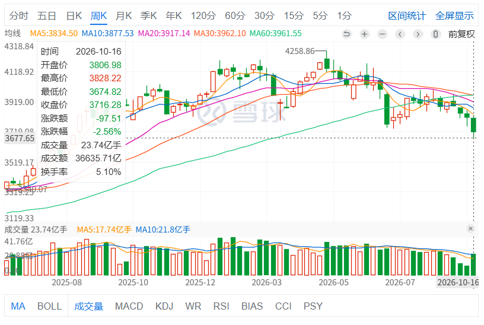

上证指数的季K 非常有规律，大概是波浪形的走势：

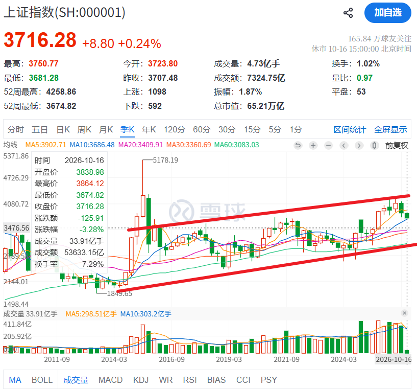

从技术指标上看，大概到 3400 左右才会止跌，目前上证指数 3716 点，大概再跌 8%。

```
>>> 3716-3400
316
>>> 316 / 3716
0.08503767491926803
```

创业板本周下跌 8.9%，目前 2772 点，从季度K上看，估计得跌到 2200 点左右。

大概还要再跌 20%

```
>>> 2772 - 2200
572
>>> 572 / 2772
0.20634920634920634
```

纳斯达克指数本周下跌 4%


纳斯达克的下跌其实还算温柔的，半导体板块被杀的连中国创业板都不如了，比如 DRAM、LYTE、NCLD，本周分别录得 18%、20%、23% 的跌幅：

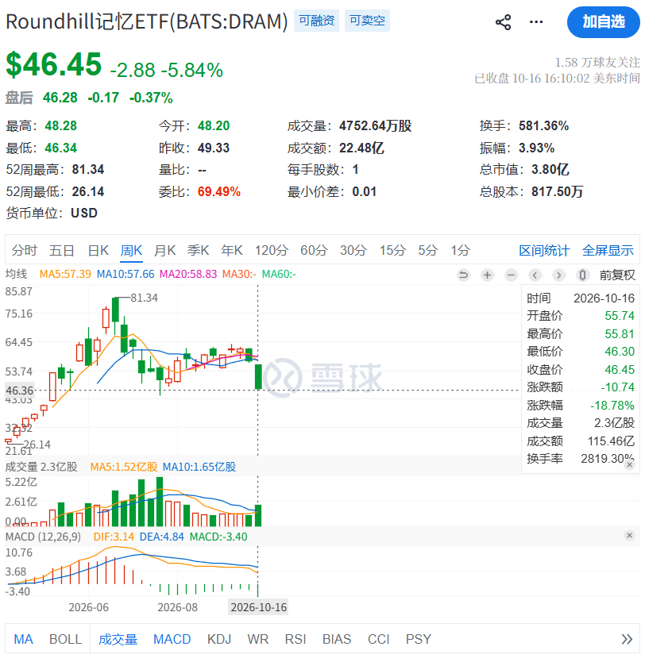
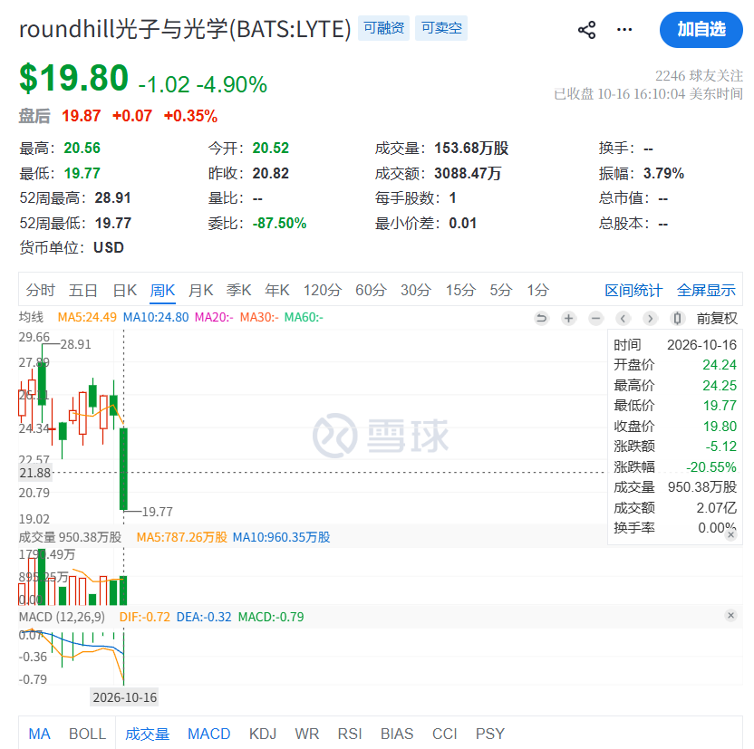
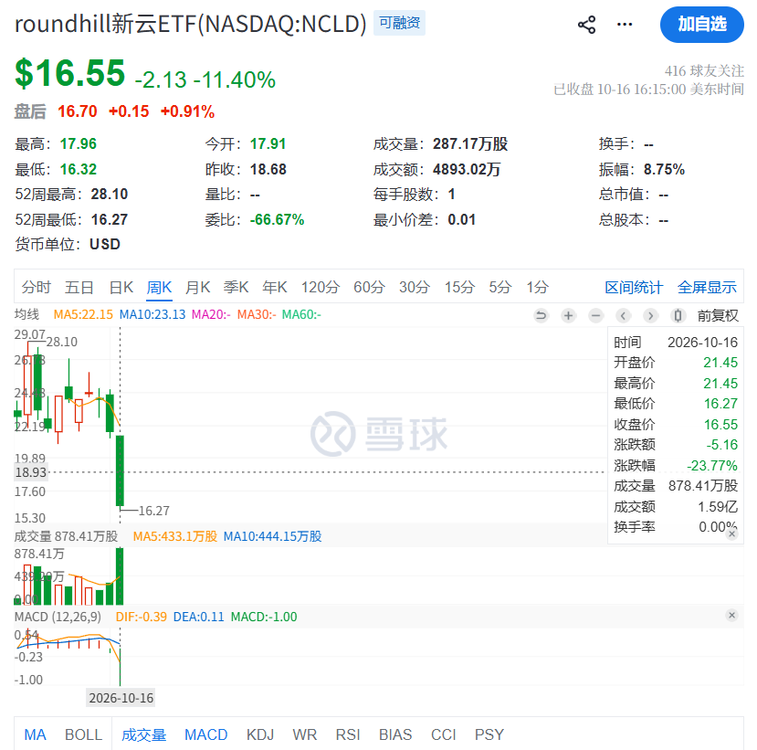

那么为什么造成下跌呢？原因是 CPI 高于预期：

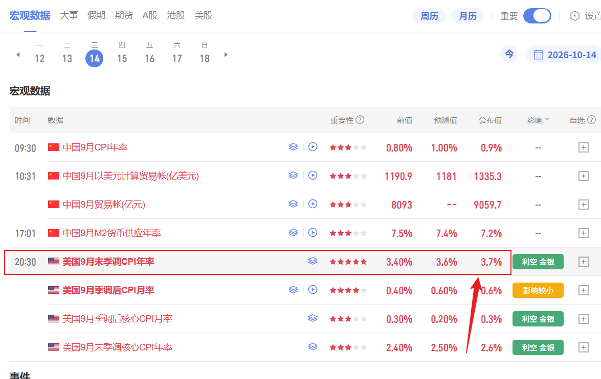

美国纳指崩了，中国科创板也好不到哪里去。

还有本周重仓的药明康德也崩了个大的：

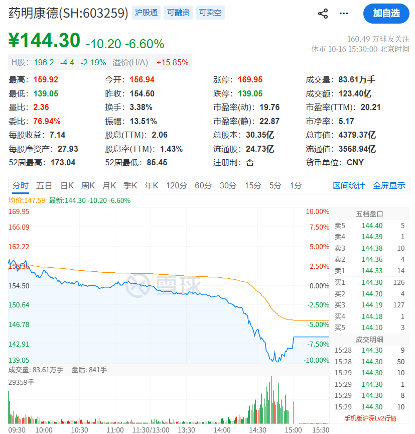

关于药明，我认为就是市场下跌了，什么鬼故事都讲得出来。比如生物安全法案要反转，药明康德又要被制裁；中国禁止高科技生物技术出口……
现在的量化程序老牛逼了，连新闻都能够成为交易信号的一部分，但是他妈的交易程序对新闻的内容真假不分、多空不分，
我估计看到「禁令」、「禁止」两个字就直接开始砸了。

## 本周操作反思

我认为自己本周 A 股的操作没有什么大的问题。首先是没有频繁交易，都在耐心等关键的板块走出来。  
瑕疵是做 T 太着急，周四在 154 买入了药明，然后周五早上高开于 156 卖出了，但是没有耐心等到尾盘再买回来。  
而且我至少忍住了去抄底创业板。

但是我觉得，其实最好的做法应该是在「看不清」的时候降低到两成仓，甚至空仓。
因为就 A 股而言，没有个股可以在大盘泥沙俱下的时候保持上涨，只能说能够挺住跌的少就不错了，最好的操作应该是在 MRNA 出利好那一天，直接清仓药明康德，谁来炒作，直接**全部**送给他就好了。

而且我觉得做 T 最高胜率的方法是「高开卖，尾盘买」，以及「新高卖，回调买」。
A 股接近零和博弈，每个人都想着抢跑，如果想要做 T，就要比最精明的那批人更精明。

本周美股的教训太深刻了。因为美股的定价非常高效，只要有利多利空的消息出来，市场几乎都是第一步快速放大涨跌幅。  
比如微软的财报和谷歌的财报出来以后，前者暴涨后者暴跌，谷歌到现在还没缓过来，而微软已经新高了。

因此小资金在美股的策略最好是在看到利多以后，股价快速上涨，考虑止盈一波甚至清仓，因为快速的上涨意味着：

1. 盈利预期被快速的兑现
2. 筹码的拥挤，各种阿猫阿狗、币圈赌狗都进来了，多空双方都会进场

而看到暂时无法证伪的利空消息，慢慢进场获取筹码。

本周我也观察到美股和 A 股类似的地方：

1. 看不清的时候，建议清仓。
2. 拥挤的时候，建议清仓

什么是「看不清」，什么是「拥挤」呢？

看不清指的是利空和利好难以判断未来的走势，比如大家都知道 AI 的 ROI 非常好，比如亚马逊的 aws 业务，谷歌的云业务，
但是发展 AI 业务需要大量的融资，会导致 CAPEX 很高挤占 OCF，导致 FCF 不足。

MAG7 这样融资扩建，会让市场上的活钱变多，推高通胀，在这种情况下，特朗普还去搞伊朗，伊朗又封锁海峡，油价涨，再次推高通胀。
好了，现在 通胀传导到了 CPI，消费者要买单了。
为了抑制 通胀，美联储要加息，又导致巨头的融资成本变高。

要是消费者因为物价太贵没法消费，给哪个巨头的营收搞出问题来，巨头还在放债，搞不好大家都得死。

像这种「看不清」的情况就是投资中的奥数题，属于是最难的部分。
应对的策略就是：看不清，就不要碰，不是自己的钱不要赚；如果说你要碰，那么仓位要非常小，而且要有信得过的人在跟踪数据才行。

再聊聊A股和美股中的拥挤现象。

我经历过一次美股的拥挤和两次 A 股的拥挤。

美股最近的一次拥挤，就是在国庆节期间，在这种「看不清」的宏观下，半导体板块带领纳指创新高。

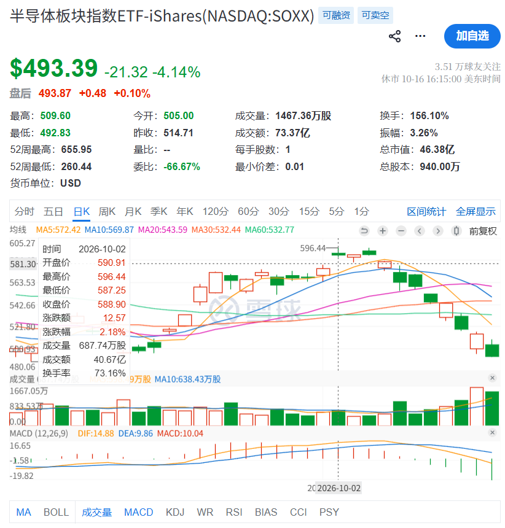
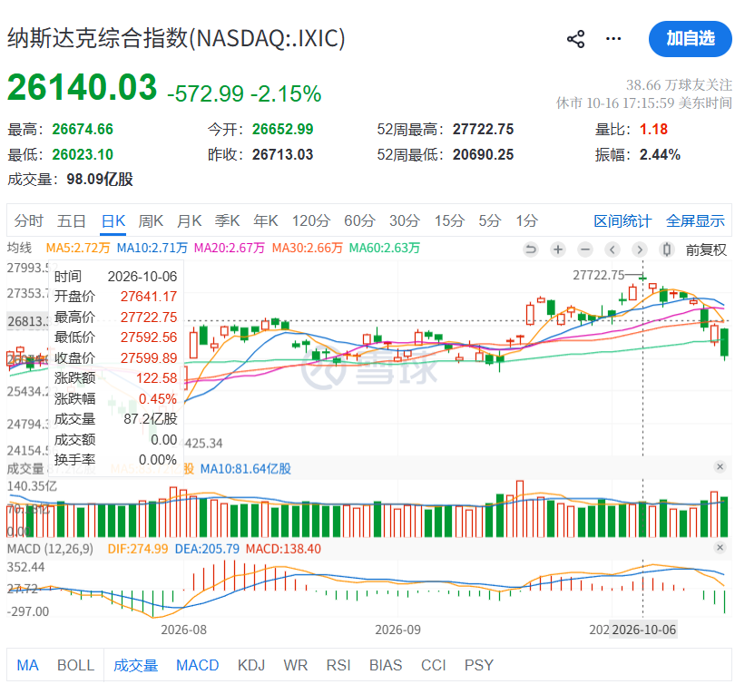

A股的第一次拥挤是今年（也就是 2026 年）初黄金价格上涨带动了一票黄金股上涨，比如紫金矿业、赤峰黄金；第二次是今年中旬公募基金抱团科创。

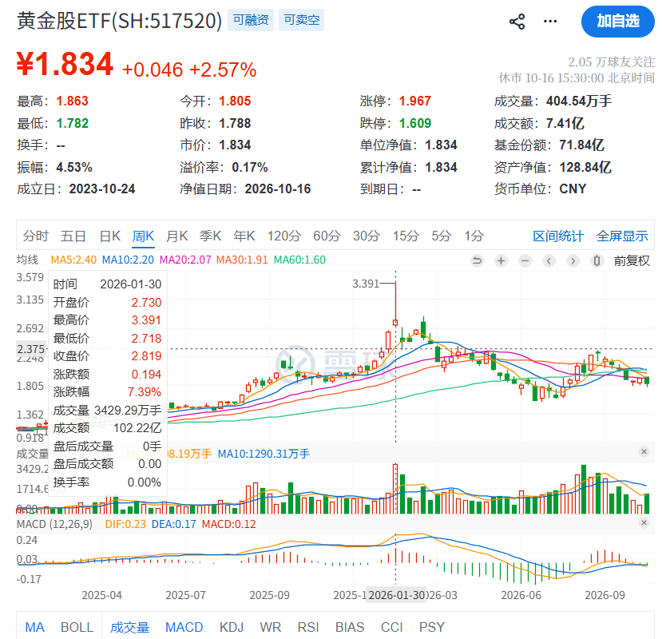
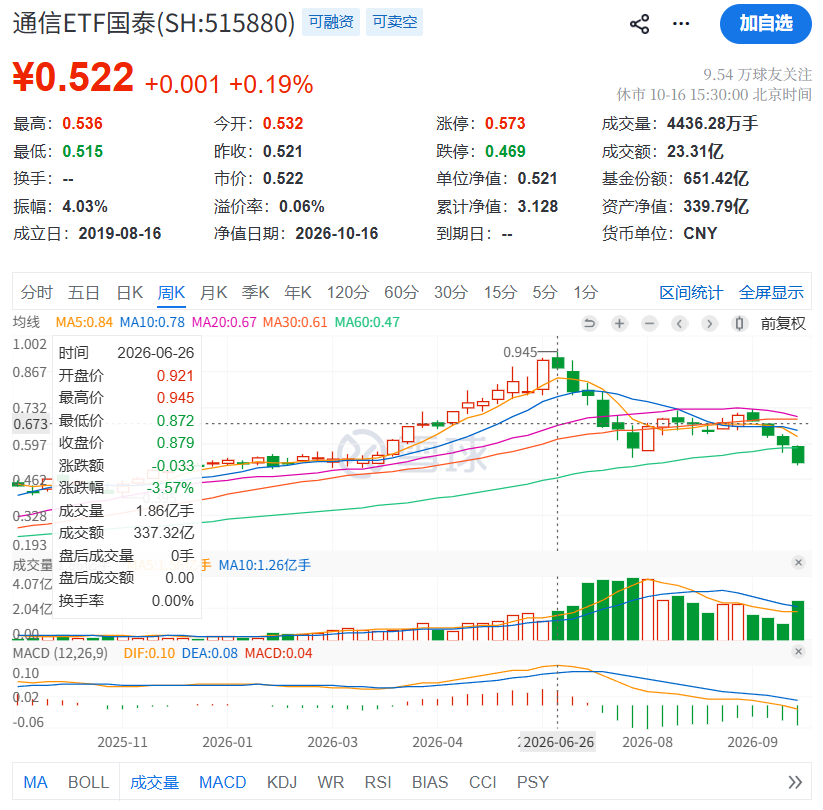
美股和A股的拥挤都有一个共同特点，就是除了一个拥挤的板块，其他板块都是跌的。  
比如年初黄金股拥挤，除了黄金股以外，其他板块被虹吸得很惨，中旬的科创也是如此。

而且，这个时候的社交媒体和炒股圈子也会有流传的黑话和段子：
像紫金矿业涨的时候，炒什么「HALO 资产」；
存储涨的时候，就是韩国女孩最好的夏天。

所以如果市场上有人觉得靠炒股就可以实现财富自由，请务必告诉我，我会考虑一键清仓。

还有一个指标，就是场内纳指的溢价率，一般场内纳指溢价率新高，美股的纳指也得要回调了。

## 后续行情看法

我觉得上证指数还得跌，科创也得跌，如果上证指数一周跌个 2% 的话，大概再 4 周，也就再一个月见底吧。  
至于美国，完全取决于特朗普，部分取决于 10 月 28 日左右 GOOGL、MSFT、AMZN 接下来的财报。  
取决于美国的那个疯子是因为 11 月 3 日美国中期大选，没人知道他要不要在中期选举前再打击伊朗。

想起来之前在上海实习，一个同事说选特朗普上去的都是极端分子，没受过教育的那种……

本周可以说是大起大落，突然想起自己曾经持有过 310 的 CLS，后来 330 左右都清仓了，  
再后来我看着它涨到了 380，感慨了一句卖飞，现在 CLS 价格是 303，跌了 22% 吧。

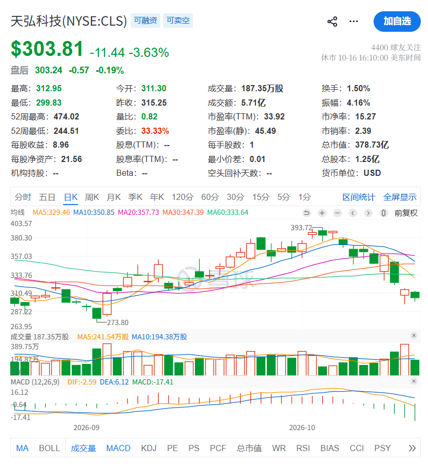

所以说美股其实并不比 A 股好做，波动巨大，杠杆还多，想要跑赢指数，操作上要非常猥琐，要跑得快。

最后，本周已经结束了，再怎么伤心也无济于事，熊市多复盘，看看自己做的不好的操作，
让一个散户欣喜若狂的时候，大概率要卖，而让一个散户非常伤心的时候，大概率是要买回来了。

## 教训

1. 美股板块新高，要非常小心，尤其是在美股这种兑现利好非常快的地方，盈利预期压缩叠加板块拥挤，应该卖掉
2. 看不清的行情要控制仓位，不能超过半仓
3. 看不清的行情，新高要减仓，A 股新高要减仓，大概率后面还能接回来
4. 拥挤的一大特点是除了他涨，其他都跌，出现了虹吸和抱团
5. 拥挤的还有一大特点是在相对高位，任何小道利空消息、财报上的瑕疵，都会导致下跌
6. 不论是美股还是A股，拥挤的情况一旦出现，需要立刻清仓
7. A股谁来炒作，**全部**送给他

## 后续计划

至于后面的行情，我认为应该是要慢慢买回来了，但是不要买太多，左侧悠着点。
大厂的 CAPEX 很多都承诺到了 2028 年，所以半导体的上游未来两年内不会有太大的问题，前提是这些 CSP 别挂掉，他们是整个 AI 支出的甲方。  
从确定性来看，台积电、美光、英伟达、博通这类属于芯片供应商，确定性大于 ORCL、NBIS、CRWV 这类带上负债的，标准就是谁的 FCF 好看，谁就更加确定。

A股完全跟着美国走，我们应该关注的是最强的股票在本轮下跌中的表现，找到反转出现的那个点，再动手。
如果指数止跌，那么强势的股票应该会先领涨；如果指数指数继续下跌，那么强势的股票应该慢慢横盘。
医药的领头就看药明康德，科技的领头就是新易盛、中际旭创，但是科技还需要看美国那边止跌了才行。

顺便分享两篇我关注的大 V 雪中滚雪球的文章，现在他也在逐步的买入：

1. [加仓TSM](https://substack.com/@xuezhonggunxueqiu/note/c-361688342)
2. [加仓点位分享](https://substack.com/@xuezhonggunxueqiu/note/c-360588820)

所以下周的计划就是：

A 股科技看美股脸色，上方套牢盘巨大，所以只需要盯住药就好了。  
在指数或者强势股没有止跌之前，不动，耐心等药和科技的反转，只需要盯住最强的股就够了。

美股继续下跌加仓，到低估值就买，但是控制仓位，依据支撑来设置买入的节点。

| 标的 | 加仓点位      |
| ---- | ------------- |
| MU   | 950, 870, 830 |
| NVDA | 210, 200, 190 |
| TSM  | 420, 400, 390 |
| MRVL | 220, 190, 180 |
| AVGO | 340, 320, 300 |

最后，投资有风险，本轮抄底的资金预估 1 年内都不会挪作他用。
