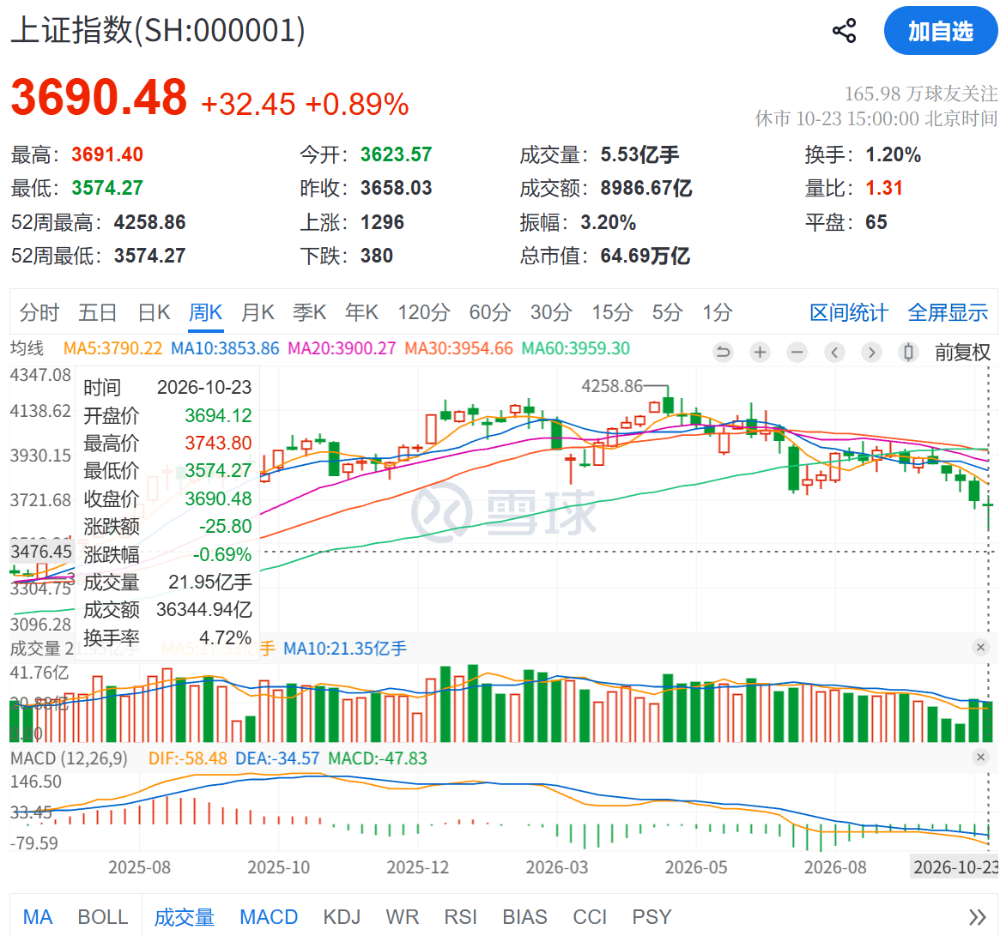
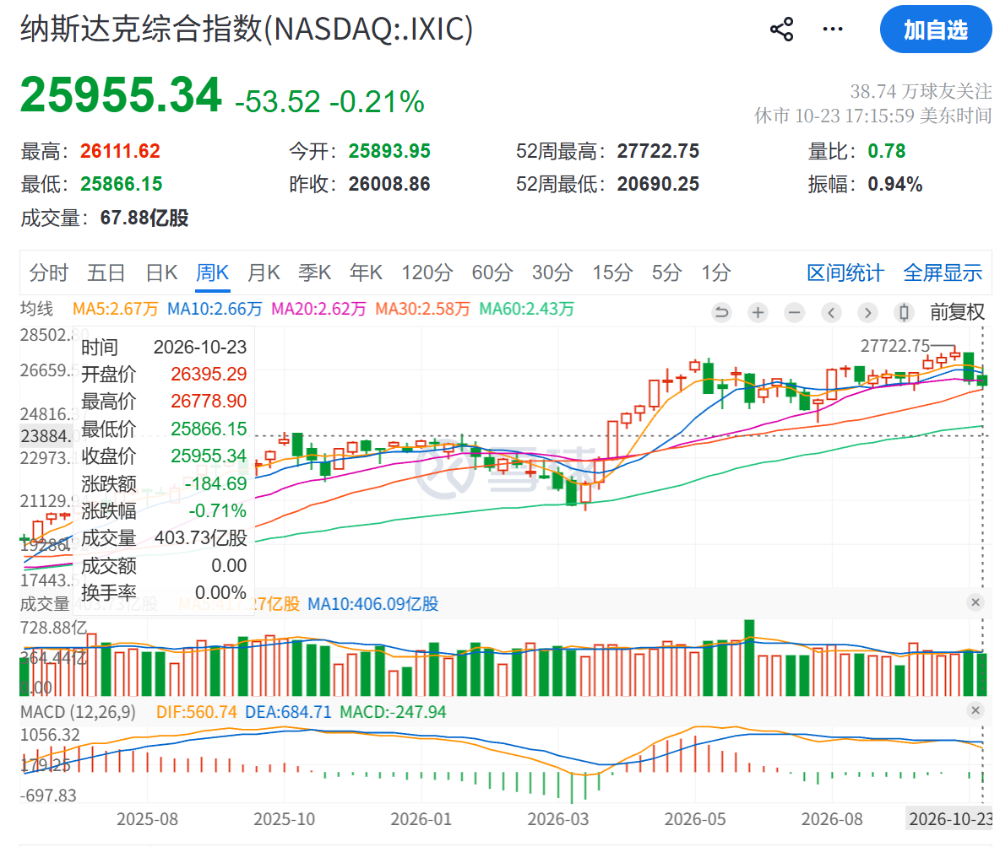
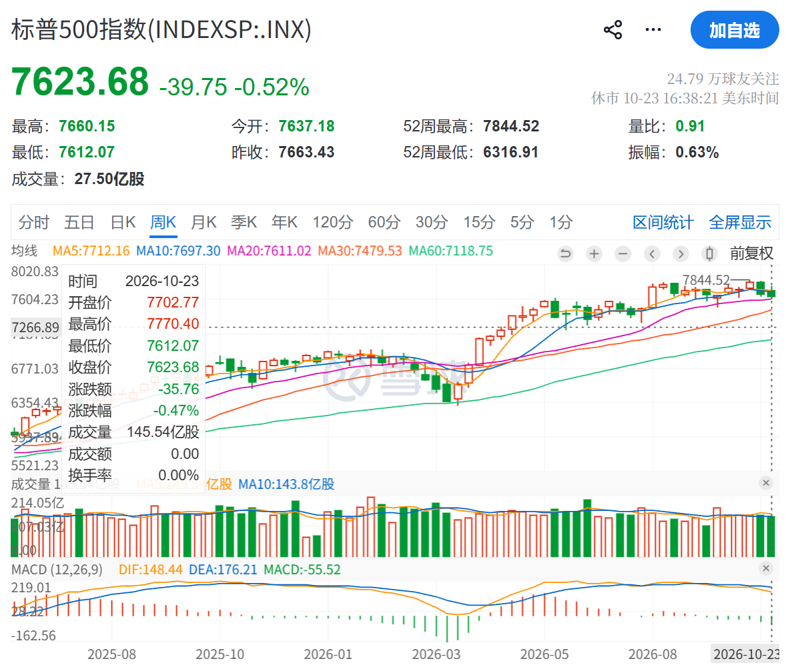
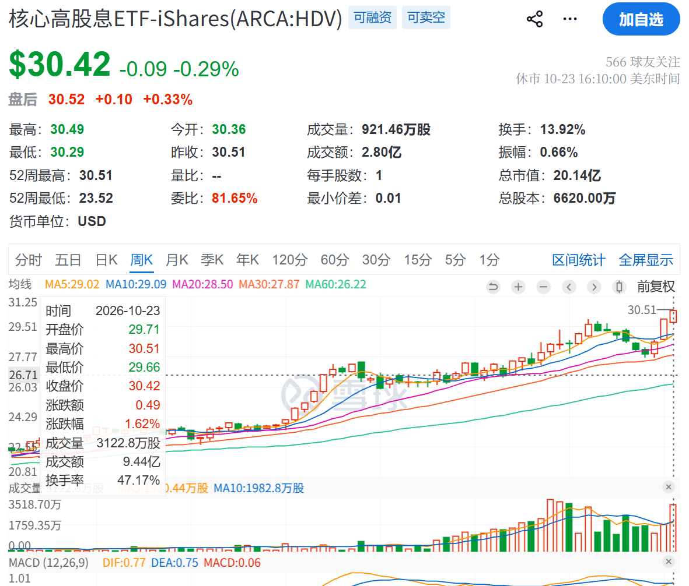
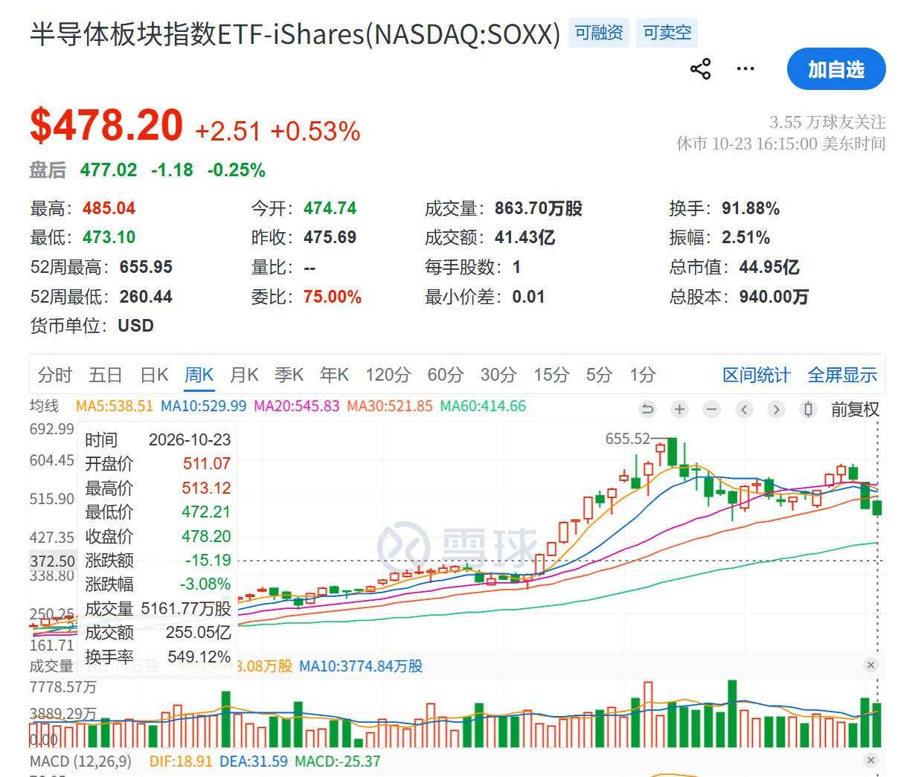
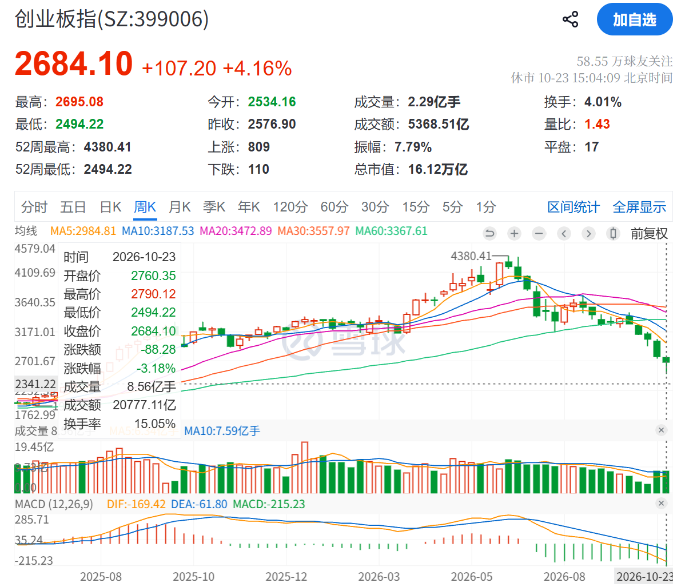
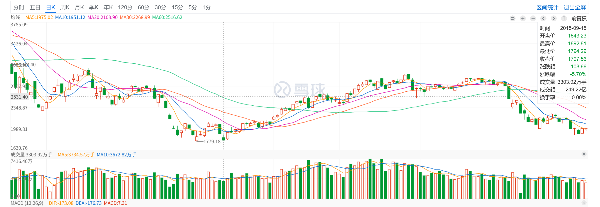
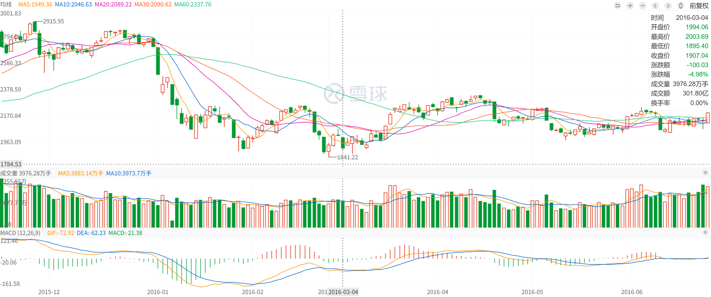
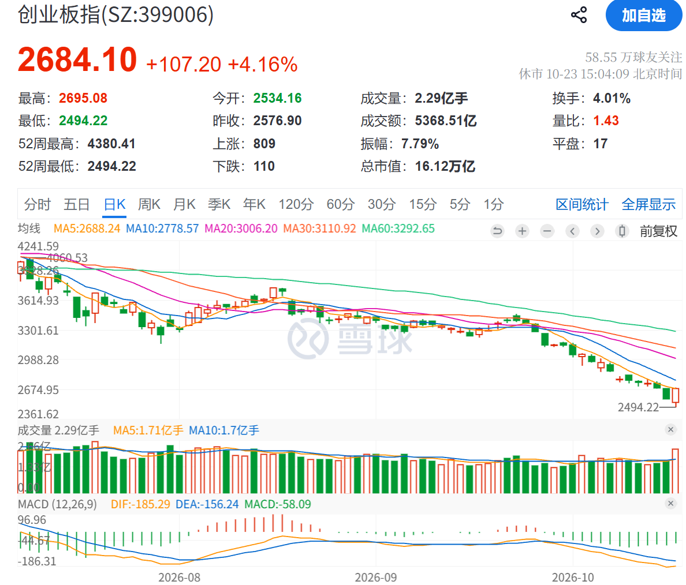

## 行情速览

- 上证指数：-0.69%

- 纳斯达克指数：-0.71%

- 标普500：-0.47%

- HDV：+1.63%

- SOXX：-3.08%

创业板指数周 K：

跌幅明显放缓，然后 HDV 跑出了超额收益，可见避险情绪很重。

## 操作反思 & 错过的机会

本周没有瞎操作，非常耐心在等待。
在周五把 CRDO、COHR 换到了 MRVL 和 LITE，希望是对的。
做的原因是，我看到 雪中滚雪球在 CRDO、COHR 和 MRVL 中，更看好 MRVL；
Darren 也换了 COHR 到 LITE。

我认为需要培养自己对公司的审美，目前我选择股票来源于博主的推荐，包括

1. Darren
2. 雪中滚雪球
3. 社会观察者

但是有时候我并不认同 Darren 推荐的某些股票。
比如奈飞、麦当劳、百事可乐、Uber，我不喜欢的原因有两个：

1. 我自己从未使用过他们的服务
2. 百事可乐劣于可口可乐，Uber 劣于 SpaceX，长远来看后者如果继续发展，前者无动于衷，后者肯定干死前者。
   简单来说，前者不是龙头。

这次看来，其实之前如果空仓也是不对的，应该买 HDV 啊！美股的跷跷板效应非常明显。

## 经验与教训

这周非常重要的事情是见证了熊市的加速下跌。  
比如 10 月 22 日可以说 A 股都绝望了，创业板指数一天跌了 4%，是上周跌幅的一半，  
然后 10 月 23 日国家队就出手了。

可见熊市一定要等绝望才出手。  
然后就是我的药明康德被大盘带崩，美国的礼来一直新高，中国的药明康德跟死了一样。

大盘下来的时候真的是泥沙俱下，我也在反思为什么药明康德 147 的本，结果 170 没走，熬到了现在 144……  
我觉得自己需要一个强制止盈的原则，我一定要锁定至少 50% 的利润。  
比如我买入后，上涨了 10%，那么如果后续回调到了 5%，我会清仓锁定利润。

我记录在了自己的 [交易规则](../trading-rules/index.md) 中。

还有腾讯是自己亏得非常惨的一个票，就是看长做短造成的。

还有一点就是要**做好最坏**的假设。因为谁能想到 SKHY 又要跌回三个月前了，三个季度只涨了 10%。

## 后续行情的看法

耐心等待药明康德、美股大厂的财报，同时做好记录，观察一轮熊市是如何筑底甚至反弹的。  
不论是 A 股的熊市还是美股的半导体熊市，我相信都是有信号可以记录的。

谢潜渊大佬（就是雪球上的@我是表好胚）提示大家去复盘 2015 年 9 月 15 日以及 2016 年 3 月 4 日。
我把创业板指数的 K 线图放在下面。

现在创业板的日 K 如下：

如果要等到一个稳健的时候，就是需要等待一个先上涨，然后二次下探再杀，然后再买回来。

所以有可能出现一个二次下杀，所以如果等到后续几天行情如果再回暖，应该卖最稳健。
如果后续几天市场情绪又非常差，应该再买。

总之下周很大可能会有比较多的操作，需要提前注意。

## 后续操作计划

美股后续我会关注自己的防守板块，我认为自己直接 70% 半导体配置 新云、半导体 实在是太激进了，
教训都是亏出来的。我知道有一个策略叫做哑铃策略，50% 科技和 50% 红利。HDV 现在涨得很好，如果半导体要回落，我看 HDV 到时候也得跌，所以下周要止盈一些 HDV，但是在后续的行情中，慢慢配置回 HDV。

A 股我倾向于会有一个反弹，我会逐步止盈药明康德，  
我理想的情况下是在 160 以上止盈，大约距离现在 10%。  
悲观情况下是在 155 逐步止盈，至少得让我解套。

因为在 MRNA 炒作的背景下，药明康德都给不了 20 fwd PE，现在都熊市了，我看能给个 17 PE 就差不多了，其实也就 140 左右吧。
17 * 8 = 136，17 * 9 = 153，高开就跑。

然后 A 股我会再关注一些防守板块的机会，比如 中国平安、中国石油、中远海控、神火股份等。
我发现这些才是 A 股的定海神针，实打实的股息给到自己。

未来每天的复盘会关注自己的持仓，现在还是太模糊了，手上的票太多，像 NBIS、COHR 这种……跌下来甚至还不如 7 月 29 日呢，还好我之前有一点 ORCL 清掉了，这钱我是真赚不到也不敢去赚。
