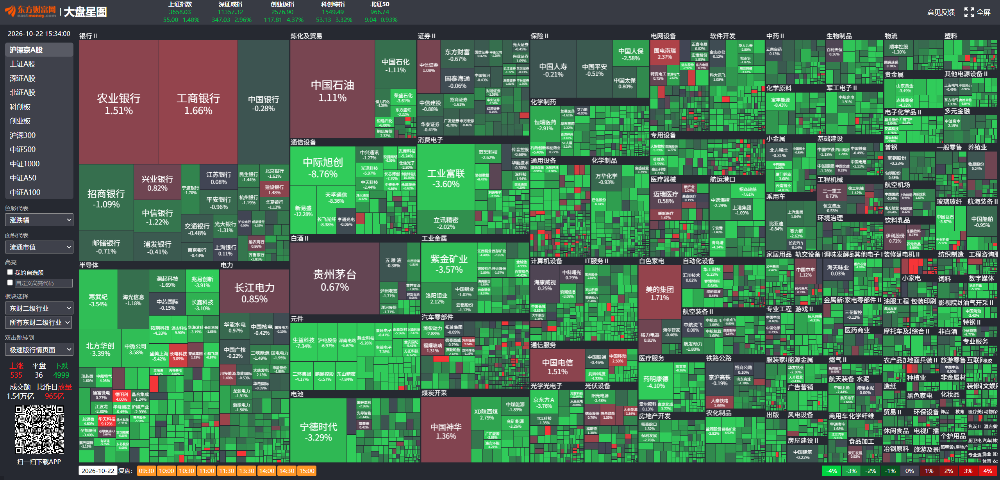
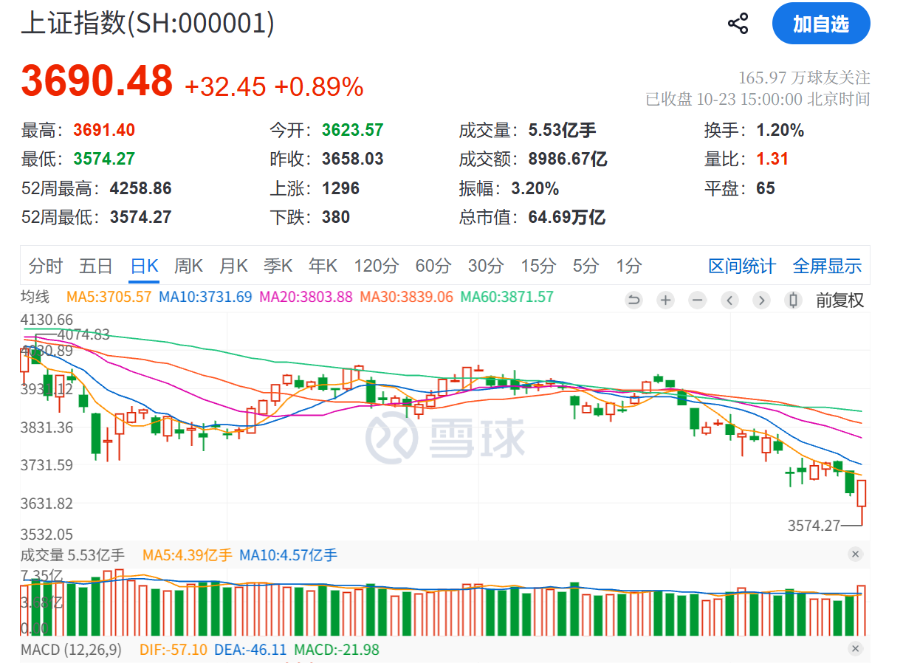
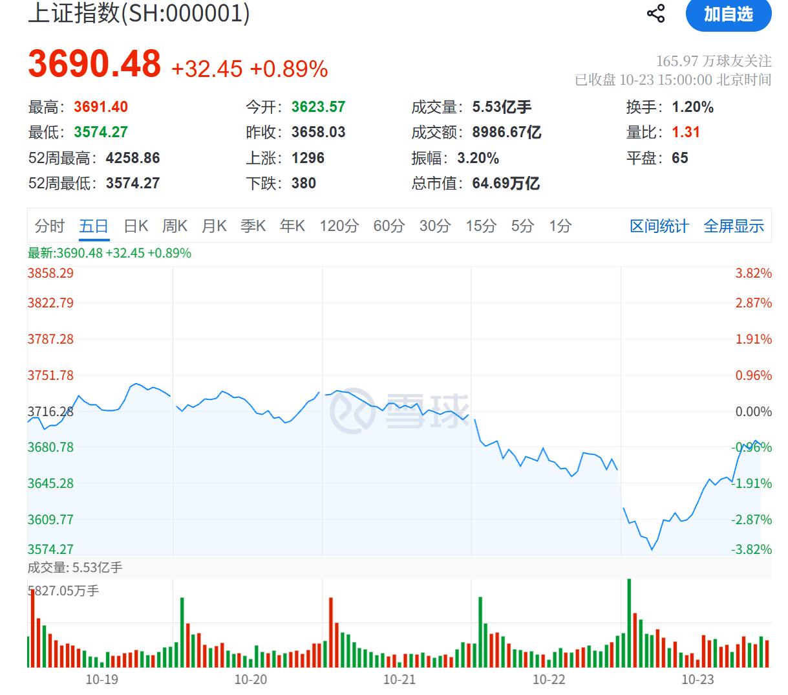
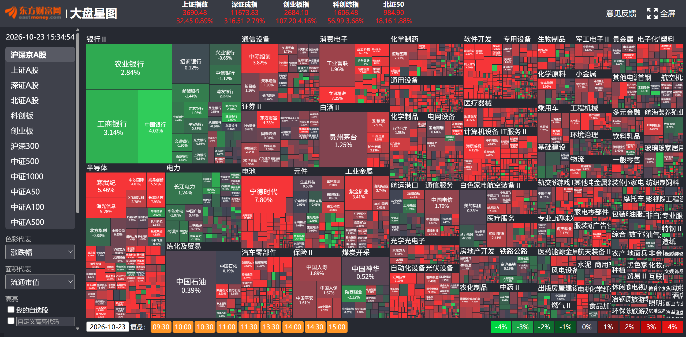
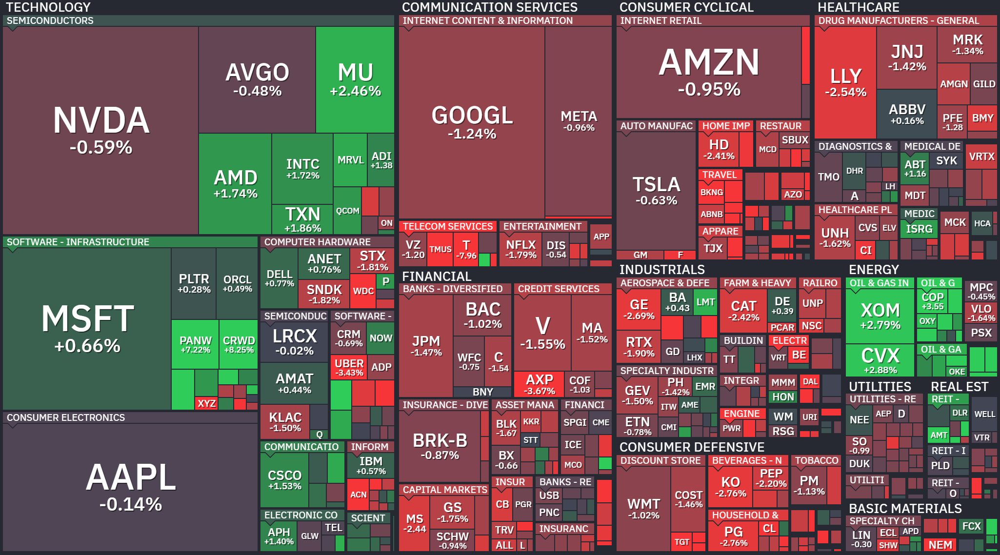

这是我的第一篇「市场周记」，我希望每天记录我对市场的观察与复盘，从而找到有价值的**交易信号**。

我认为复盘的本质是综合各种**信息**，找出历史上最类似的场景，进行严谨的分析，推断未来的走势。

那么什么是信息，信息包括哪些？

有人会说，不断变化的**叙事**就是信息。  
比如上周半导体涨多了然后开始回调，有人说这是因为 OpenAI ARR 不及预期，所以跌了。  
OpenAI ARR 真的不及预期吗，后面不是又说 ARR 算法有所调整，但是市场为什么照样跌下来不涨呢，不就是因为多头太多踩踏了吗？

所以我认为这和小学生**看图写作**没啥区别，对交易也没有什么指导作用。
合适的观点应该是，这个时候一篇小作文就能导致跌这么多，说明多头的仓位太拥挤了，不论仓位轻重现在应该**立刻减仓**。

所以我认为市场表面上由不断变化的**叙事**推动，但实际是在筹码、基本面的基础上，由**不断更新的信息**推动。

信息有如下类别：

1. 指数的涨跌，如上证指数、纳指、道指等
2. 一些指标，比如 美元走势、VIX 等
3. 个股的涨跌以及个股之间、个股和指数之间横向的比较
4. 财报
5. 小作文，比如 OpenAI ARR 不及预期这种新闻
6. 散户的情绪，在散户群中观察散户的操作

我们每天要复盘的，就是观察各种信息，估算筹码和检查基本面，结合行为金融学和历史上相似的时刻，做出自己的决策。

所以我打算将每天的复盘分为如下几个部分，有就写，没的话就略过：

1. **观察和总结**：指的是对**信息**的观察。  
   不仅仅是股票的涨跌是信号，国家队的操作、小作文、散户群聊的情绪、互联网的文章都可以是信息。  
   最后需要对当天的观察做总结，可以浓缩成一句话，方便未来回看
2. **今日之鉴**：假设今天放到历史上看，会因为什么成为未来的一个历史参考点。
   有点儿像一个不断追踪记录的课题，比如「A 股熊市出清观察」、「美股半导体如何反转」。
   我们本身就处于一个被观察的周期中，比如我们目前处于一个半导体下跌的周期中，A股的熊市中，
   我们要记录今天在这个周期中有哪些信息，当未来处于一个类似的周期中，我们可以检索上一个周期中记录的信息，做到按图索骥。
   不仅仅是周期，对于个股也有可写的，总之，今天的什么事情，可能对未来有什么参考意义，都需要记录下来
3. **回顾历史**：寻找历史上最像今天的时候
4. **经验与教训**：如果复盘有所感悟，应该写下来，然后记录到一个大的规则中
5. **猜测未来**：通过回顾历史，考虑筹码分布、基本面来预测个股、指数的涨跌，个股的相对强弱，需要上面两个步骤分析完了才能做到
6. **今日交易**：记录今天自己的交易，交易的理由是什么。赚钱了还是亏钱了，卖飞了吗，为什么？也要沉淀到规则。
7. **交易计划**：后续交易的计划。如果发生什么，要怎么应对，这种才是交易计划

美股和 A 股均会复盘。美股盘后交易为美东时间 **16:00–20:00**，对应北京时间：

- 夏令时：次日 **04:00–08:00**
- 冬令时：次日 **05:00–09:00**

每天早上起来复盘美股，下午收盘后复盘 A 股。

因为工作太忙，本周漏写了一天。希望下周如果不忙的话，可以做到每天都复盘，要坚持。

## 近期大事一览

| 10.21（周三）       | 10.22（周四）  | 10.23（周五） | 10.27（下周二） | 10.28（下周三） | 10.29           | 10.30          |
| ------------------- | -------------- | ------------- | --------------- | --------------- | --------------- | -------------- |
| 盘后 NFLX 财报      | 盘后 TSLA 财报 | 盘后 BE 财报  | 药明康德财报    | 盘后 SKHY 财报  | 盘后 GOOGL 财报 | 中际旭创财报   |
| 盘后 SPCX 财报      | 盘后 LRCX 财报 | 盘后 WDC 财报 |                 |                 | 盘后 MSFT 财报  | 盘后 AMZN 财报 |
| 17:00 NVDA GTC 大会 | 盘后 META 财报 | ESMO          |                 |                 |                 | 盘后 INTC 财报 |
|                     | 凯莱英财报     |               |

## 2026-10-20 A 股收盘

### 观察和总结

**大盘下跌，国家队快收盘才动手聊表心意；鸡贼宁德时代，回购磨磨唧唧一点都不爽快**

大盘整体：

- 很弱，最后半个小时，国家队买了沪深 300 和科创 50 护盘

关键个股：

- 宁德时代今天大跌，盘后有财报
- 中际旭创：继续跌
- 洛阳钼业 -7%

最重要的信号就是宁德时代今天暴跌了，往日多风光，今天多凄凉。  
从 K 线上看，破了 250 MA以后几乎是势如破竹。
而且宁德时代说要回购，迟迟不动手，规则里需要加一条：远离说了要回购却迟迟不回购的企业。

参考文章：

- [每日总结 by 猫笔刀@微信公众号](https://mp.weixin.qq.com/s/NegdhGt4Ec-H0439gd6gcw)
- [宁德时代三季报粗解 by 吕执着@雪球](https://www.xueqiu.com/5673225518/413091174)

### 今日之鉴

我觉得今天甚至未来这段时间，可以作为观察熊市的典型例子。  
比如指数、散户情绪、个股的走势、国家队是怎么出手的，未来可能都会有参考价值。

可以看到国家队出手买了一点，但是不多，估计也就是意思一下。  
然后熊市其实财报也很危险，一旦有利空，先砸再说，而且宁德时代回购也不爽快。  
熊市横盘的股票要少看，太危险了。

## 2026-10-20 美股收盘

### 观察和总结

**SPCX的财报暂时阻止了半导体的暴跌**

- 纳指横盘，低开拉升
- 金融板块，如 V、GS 涨的好
- 礼来历史新高
- SPCX 盘后 +8%，资本支出还在，新云、存储、光 盘后也拉升
- NFLX 财报，跌

观察到半导体还是比较弱，即使 spacex 承诺说未来会搞很多算力，可还是没有走出很坚定的行情。
要知道之前可是跌停如山倒。

### 今日之鉴

这段时间可以作为美股半导体走熊的观察例子。
观察一个暴涨新高到快速回调的标的，在面对一系列事件，比如财报、高通胀预期，是怎么个走势。
是继续震荡，还是累积到足够的好消息然后 risk on？

## 2026-10-22 A 股收盘

### 观察和总结

**下跌加速，一天跌半周**

指数：

- 上证指数：-1.48%
- 创业板指：-4.37%
- 药明康德：-4.10%
- 中际旭创：-8.76%

合影留念：

上证指数和创业板指数一天达成上周一半的跌幅。
科创板今天是跌幅最大的一天。
回头看之前的每一次反弹都是逃跑的机会。
只有银行是坚挺的。

事件：

- 凯莱英出财报，CXO 周期还在上升：[凯莱英三季报粗解 by 吕执着@雪球](https://www.xueqiu.com/5673225518/413459782)

从情绪上看，今天是真的股灾了，大家开始绝望了：[整个世界都绿了 by 猫笔刀@微信公众号](https://mp.weixin.qq.com/s/G9s853DcQ30UdrYo13R0WA)

### 今日之鉴

我认为至少有两个事情可以后续追踪并作为典型例子。

第一个是指数的加速下跌筹码出清过程的记录。可以说熊市的一个标志就是加速下跌，如果没有出现，很难说出清了。
我认为这是熊市出手的一个必要条件：观察到加速下跌才能出手。
不然前面抄底光模块、科技的，都挂在半山腰了。

第二个是观察一个反转周期在熊市是如何发展的。
比如 CXO，是反转的，美股礼来最近一直新高，凯莱英的业绩也符合预期，但是很可惜药明康德和凯莱英生在熊市。

### 回顾历史

我认为没法预料到今天的大跌，光从我昨天观察到的数据来看。
但是至少，如果出现白马股的大跌，**其实预示着第二天往往是不妙的**。
总之今天是非常重要的一天，切实体会到了熊市。

其实历史上也有类似的情况，就是熊市以后，一天杀一只白马股。
昨天是宁德时代，今天就是中际旭创。
而且杀是无差别的，管你基本面多好。

熊市是不会管你估值的。

- 越是之前拥挤的股票，被剁的越惨。参考 中际旭创
- 越是有利空消息的股票，跌的越惨。参考 宁德时代

如果回到昨天我会怎么操作

如果回到昨天，我有创业板的仓位的话，看到宁德时代跌这么多，我会直接剁掉。
如果今天我有创业板仓位的，我也会清仓。

### 经验与教训

非常庆幸之前都没有抄底什么光模块之类的。
我认为熊市需要耐心等筹码出清，一个重要的标志是加速下跌。

### 猜测未来

指数：明天还得接着跌

个股：易中天还得接着跌，美股走不出来别看了。就是不知道杀哪一只白马股。

凯莱英财报符合预期，药是 A 股唯一可以做的。
所以我猜测明天药的走势会好于光模块。
但是，药明天也有跌停的风险，无非小一点罢了。

我认为大概还有一周见底。必须要等到 MSFT 等巨头财报出来。

### 交易计划

A 股我选择不操作，不会砍仓 药明康德，还有一些小票我也不会砍仓，
但是我会关注下，如果跌的更多，我会加仓，但是一定是在大盘走好或者说到了支撑位我才会去加仓。

不过再跌下来我只会买 CXO 和 红利低波。

但是我未来估计会不再买这种云铝、神火小票了，因为我跟不住数据。
我会切换到红利低波上，但是红利低波我还需要确认下股息率才行。

## 2026-10-22 美股收盘

### 观察和总结

**美股半导体又死了，BTW，带着 SPCX 一起**

半导体继续下跌，涌入金融和消费、医疗板块

- NVDA -4%
- SPCX -9%
- LRCX -11%
- AVGO -4%
- MRVL -8%
- QQQ -2%
- VOO -1%
- LLY +2.8% 新高

### 经验与教训

我觉得自己要小心 这种 FCF 不好的企业了。
比如 ORCL 和 NBIS，这种搞融资的企业就别买。
市场一恐慌直接爆炸。

昨天我也不看好 SPCX，ORCL、NBIS 都在搞融资建立算力，凭什么你可以涨？

### 猜测未来

我认为还是要等待谷歌的财报出来
因为现在市场需要一个事件来证明，AI 目前的融资可持续的。

市场现在还是比较脆弱的。因为现在任何一个财报出来，都是直接砸，如果彻底出清，那么其实是再悲观也砸不下的。

### 交易计划

操作需要考虑：

1. 未来事件
2. 关键指标
3. 企业的估值和现价
4. 大盘

总体仓位控制：应该计算出一个我在左侧最悲观的预期，就是说我左侧最多加到多少仓位
然后分配到每个股票上的仓位。
然后再每个股票上会加到多少仓位。

一些企业已经逐渐进入支撑位，应该继续加仓。
如 MU、MRVL，今晚会继续加仓。

大盘已经深度回调了。

## 2026-10-23 A股收盘

### 观察与总结

**大奇迹日，国家队开盘买到收盘，昨天割肉的傻眼了**

- 上证指数：+0.89%，开盘破位下跌，后续被拉起来
- 创业板指：+4.16%，中午 13:00 以后一开盘就被拉起来了。

### 今日之鉴

今日是绝佳的观察熊市的样本。我们看到国家队出手了，可见真正的熊市永远不着急抄底，完全可以等国家队买了再说。
国家队不等到绝望是不会进场捡尸体的。

### 经验与教训

见底的两个重要信号：

1. 散户群聊都死气沉沉，没人在说抄底科技了。
2. 指数**加速下跌**。

今天我想到一条非常重要的原则，就是保住盈利的原则。
比如我在一个股票上获得了收益，那么，我应该在回撤超过一定程度比如 30% 的时候，做减仓，
然后在回撤超过某个阈值的时候，立刻清仓。

这样至少可以保住我的收益。
因为价值投资者不会在上涨以后买入，而在下跌趋势下可能吞噬盈利，
如果收益回调 50% 绝对是非常多了，清仓离场保住利润很重要。

### 猜测未来

维持观点不变，我觉得底部临近了。这里已经是一个绝望的底部。  
按照我的预期，应该跌到 3400 左右，本来再跌两三天就到了，但是国家队出手了，如果不出手就是接着恐慌接着杀下去。  
所以指数现在这里到底是横着，还是阴跌都说不准。

## 2026-10-23 美股收盘

### 观察与总结

**半导体横住了没有继续下跌**

大盘：

- QQQ：-0.01%
- VOO: -0.53%
- MU: +2.46%
- LITE: +0.48%
- TSM: +1.49%

### 回顾历史

这一轮和 3 个月前 7 月 29 日暴跌非常像。看 SKHY 目前 137，上一轮暴跌是 124 元。  
科技的 CAPEX 没有任何变化，从 MU、SPCX 等财报可以看出来，算力的开支还在继续。  
唯一的变化就是那个疯子要打伊朗，然后 CPI 超预期。

如果上一轮是底部，那么其实只有 10% ~ 20% 的下跌空间了，这个时候应该加仓。

| 标的 | 7 月 29 日价格 | 现价 | 涨幅    |
| ---- | -------------- | ---- | ------- |
| SOXX | 463            | 478  | 3%      |
| SKHY | 124            | 137  | **10%** |
| NVDA | 189            | 210  | 11%     |
| MU   | 737            | 877  | 18%     |
| LITE | 594            | 756  | 27%     |
| SNDK | 998            | 1238 | 24%     |
| TSM  | 371            | 418  | 12%     |
| MRVL | 162            | 228  | **40%** |

### 经验与教训

其实这一轮下来，已经可以再次观察到一种类似的叙事了。

就是从大家说 Situational Awareness 爆仓，以为风险已经出清，到再创新高，然后再次快速下跌。
就是叙事的变化是非常快的，然后估值被叙事兑现的也非常快。

所以在美股一定要学会止盈。

从高点快速下来的时候，往往是某个叙事，然后被逐渐地放大，导致连环爆仓。
高点不一定有那种狂热的信号，比如「韩国女孩最好的夏天」，但是如果有鬼故事导致快速下杀，
在拥挤的情况下，是可能导致连环爆仓的。

而且就算杀了一波多头，然后新高，后面的走势也是**完全无法预测**的，后续的行情当然不排除新低。
但是算下来，其实已经杀了两波多头了，而且第二轮的底部甚至距离第一轮的底部非常接近。

### 今日交易

COHR、CRDO 换仓 MRVL 和 LITE。  
并增加 MRVL 和 LITE 仓位。

- MRVL 225
- LITE 757

这是一笔左侧交易，如果观察到 CAPEX 放缓或者公司基本面的变化，我会清仓。

### 交易计划

如果下跌，我会继续加仓，但是会按照支撑位来加仓。  
如果走出来，我会进行右侧交易。

| 标的 | 支撑     |
| ---- | -------- |
| MRVL | 205，170 |
| LITE | 715，596 |

LITE 是一只波动非常大的票，基本上 120 日没有支撑。
