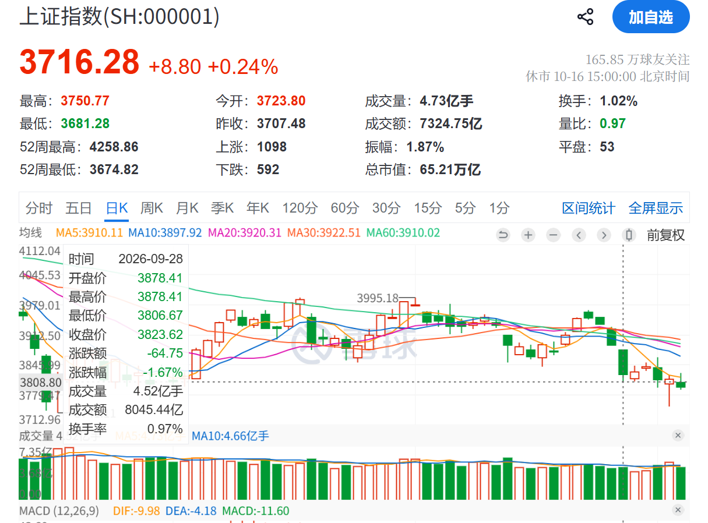

本文记录投资以来做的好的、不好的操作，仅作为复盘之用，持续更新。

以下内容摘自 [从交易和投资角度辅助判断买卖点](../trader-investor-buy-sell/index.md)

在买点上，投资者应该只在价格大幅低于内在价值的时候买入以获得足够的安全边际，但是这只是一个**必要不充分**条件。  
买入的同时应该观察大盘、个股的阻力和支撑，我认为有以下买点：

1. 基本面超预期。公司内在价值大幅提升。
2. 个股接飞刀的买点。大盘下跌，心仪的公司也一路向下，买点应该设置在支撑位附近。
3. 大盘反转的买点。大盘止跌反转，心仪公司均线开始向上逐步走出多头。
4. 共振的买点。因为在下跌过程中只能分批加仓，所以仓位大概率是不够的，而在确定走出多头，大盘和公司股价一起上涨时，应该顺势加仓。

关于卖点：

1. 企业基本面恶化或者自己估值计算错误。
2. 价值回归的卖点。因为价值投资者只会在价格低于内在价值的时候买入，所以在价格回归合理区间的时候，需要止盈。
3. 短期炒作的卖点。即使公司的基本面非常好，但是如果有人突然来炒作，使得公司的股价迅速靠近合理区间，也需要止盈。
4. 大盘萎靡的卖点。大盘萎靡不振，甚至已经有向下势头，个股很难做到不断突破新高，而是处于一个横盘的状态。
   理想的牛市是不同板块轮流上涨，一旦没有哪个板块可以带动大盘，大盘极有可能急转直下，所以要减仓控制仓位。
5. 大盘恶化的卖点。大盘如果确立下跌走势，强势股往往补跌，如果此时仓位是在上升过程中减小的观察仓，斩仓要非常坚决。

关于仓位，仓位只和确定性有关：

- 如果你很确定这个票未来会上涨，应该重仓猛干。
- 如果你很没有把握这个票未来的走势，应该控制到较低的仓位。
- 如果你很确定这个票未来价格会更低，应该直接清仓。

当确定性发生变化时，仓位也需要变化，所以我们要及时评估确定性，在确定性变高的时候加仓，在确定性降低的时候减仓。

| 时间       | 标的     | 方向 | 买卖点归类       | 具体原因         | 仓位               |
| ---------- | -------- | ---- | ---------------- | ---------------- | ------------------ |
| 2026-08-04 | 药明康德 | 买   | 企业基本面超预期 | 净利润断层       | 重仓买入           |
| 2026-08-20 | 药明康德 | 卖   | 短期炒作         | MRNA 炒作        | 重仓卖出           |
| 2026-09-30 | 药明康德 | 卖   | 大盘萎靡         | 指数萎靡个股苦撑 | 削减仓位，保留底仓 |

## 买 | 基本面超预期

### 2026-08-04 药明康德

药明康德出财报，业绩炸裂，具体可以参考吕执着：[这篇文章](https://www.xueqiu.com/5673225518/403460885)。
简单来说，一个指引翻倍到 35% 且从周期底部拐点的行业，只给到了 20 FWD PE，属于低估。
然后大盘此时也不差，属于确定性的机会，应该重仓买入。

这一笔我做的比较好，平均成本 145 买到了半仓。

## 卖 | 短期炒作

### 2026-08-20 药明康德

美国 `$MRNA` 这个票三期过了，有人就来炒作大 A 的映射。
但是药明康德和 `$MRNA` 没啥关系，也不是上下游，药明康德做多肽业务的。
如果有人来炒作，直接把给全仓给他。

这一笔我没做好，只 T 出去了 1/4 的仓位，应该全仓卖出的。
因为 A 股属于价投圣地，只要有人来炒作，一定有机会接回来。
大不了后续全仓买回来就好了，耐心等待。

## 卖 | 大盘萎靡

### 2026-09-29 药明康德

9 月 28 日这根上证指数的阴线，确定了大盘已经很差了。  
因为如果能够反转，指数会突破前期的高点，这里不但没有破前高，还破了 9 月 16 的前低。

在下跌趋势已经确认的情况下，只剩下药明康德苦苦支撑。  
如果这个时候药明康德能够横盘挺住，那么后续指数回弹的时候，大概率会创新高，  
但是在 A 股一个指数很差，并且可以说破位向下的时候，这种成长股很难独善其身。

这个时候，药明康德的确定性显然是没有财报出来净利润断层时候那么大了。  
既然确定性下降，那么仓位就没有必要和原来保持一致。

这一笔我没有做好，甚至想在这里做 T。

前期药明康德已经有了较大的获利盘，在这里选择获利了结，然后等待一个反转是确定性更好的做法。
**我们不能只看到未来可能的预期，忽视短期的风险**。
