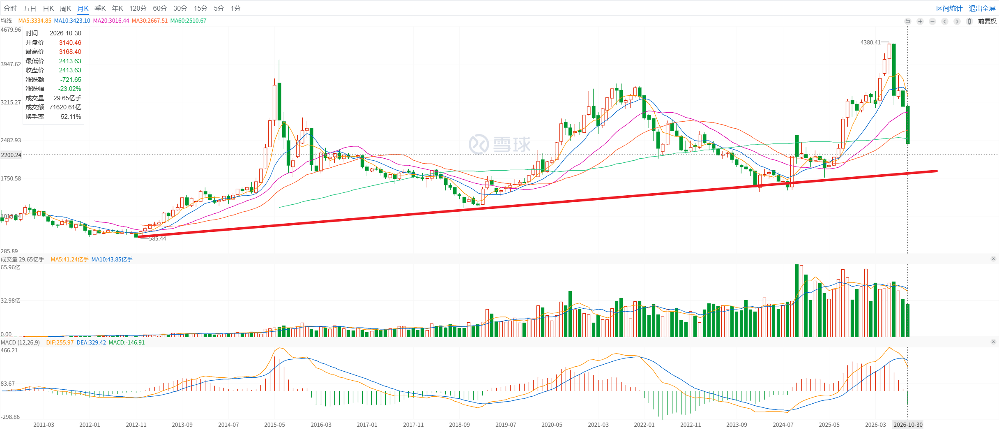

## 行情速览

- 红利低波：+3.9%
- 创业板指：-10.08%，收 2413.63
- 上证指数：-2.48%，收 3599.02
- 纳指：-2%
- 标普 500：-0.57%
- HDV: +2.04%

A 股加速出清，创业板距离我内心的点位 2200 只差一个跌停了，上证指数距离我的点位 3400 也只差不到一个跌停。当然，没有人可以预测市场，未来怎么走还是未知的，更何况 A 股还是跟着美股走的，但是这里应该乐观。

## 本周大事

本周 Google、Amazon 发布财报，FCF 都负数了。虽然两家的云业务还在高速增长，市场却不买账。
INTC 财报 miss，一天下跌 30%，MRVL 想要收购 LITE，本周下跌 14%。

我觉得市场是相互矛盾的。

1. 首先，AI 的 CAPEX 侵蚀了 FCF，导致财报不好看。那么谷歌和亚马逊死得其所。
2. 如果这样，其实半导体的资本开支还在，MU 和 SKHY 等科技股其实没必要担心。
3. 市场杀 MU 等半导体上游，说明市场认为现在 CSP 的资本开支不可维系。
   MU 等企业已经到达了周期的顶部，给了一个非常低的 PE。
4. 如果资本开支是不可维系的，那么 Google 和 Amazon 的估值也不应该被杀，因为 FCF 只是暂时不好而已。
   要是真的不可维系，大厂未来就不会有很高的 CAPEX，FCF 会好转，美国的通胀也会好转，至少市场上没有那么多活钱了。大厂也有动力回购股票。

如果去赌资本开支不可持续，那么明年 Google 等公司的 FCF 就会好转，现在正好 buy the dip。如果去赌算力周期还没有见顶，那么 MU、SKHY 的 fwd PE 还会更低。双杀其实必然有一个被杀错了。

目前已知的消息是，海力士和美光说了 2027 年的产能已经被锁定了。2028 年的产能也在洽谈。  
接下去有两种可能路径：

1. 算力开支真的见顶了，大厂发现 AI 的投入不划算，于是开始砍 CAPEX，MU、AMD、NVDA 一众上游都死了。
2. 大厂继续增加算力开支，拼了老命也要实现 AGI。但是现在的 AI 显然只能给白领用，而且除了 coding 外，还没有创造出更多可供消费的劳动产品。

## 我对未来科技发展的预测

AI 想要进入普通人的日常生活，还有很大的问题。最具想象力的是机器人，但是具身智能现在还非常初级，没有企业做成 AI 机器人的商业模式闭环。很多机器人现在都是噱头，没法大幅提高生产力，更谈不上变革现有的生产关系。

所以说这是道奥数题。

目前我自己最看好的模式是：Google、Amazon 这些厂子继续提高 CAPEX、提供云服务。现在云服务其实增长得很好，越来越多的企业会向 Azure、AWS、GCP 购买算力，甚至还有 SpaceX 来分一杯羹。然后，很多科技初创会集中精力做具身智能，因为一个国家的根基还是农业和制造业，农业和制造业才能带来更多可供消费的产品。  
互联网再发达，赚的也是推荐系统、订阅服务、物流这种有上限的东西，只有 AI 真的取代了体力劳动，才能实现更高的增长曲线。目前特斯拉在做这件事，但是不知道做到了什么程度。

所以我认为大厂会 ALL IN 这个方向，不会削减算力开支，因为大模型让他们看见了曙光，而且还有很多初创也在搞具身智能。在 scaling law 被证明有效的基础上，训练大模型仍然需要算力，也需要视频这类数据。一旦 AI 能够在某个领域建立可验证的反馈方式和数据采集体系，这个过程就会自我加速。

这些大厂的 FCF 具体什么时候转正，说实话我也不知道，走一步看一步吧。反正最后大概还是会转正，因为它们有自己的业务提供现金流。等到具身智能的模式真正跑通，能够吃到红利的一定是参与机器人制造产业的企业，尤其是销售机器人推理芯片的大厂，比如英伟达、博通、高通、谷歌。  
到那个时候，MU 这类企业还能吃到一波机器人进入工业生产的红利。但是第一轮铺设结束后，机器人可能很久都不需要迭代，MU 也会重新陷入周期。

但是目前半导体上游的增长是有限度的，因为半导体现在的投入都来自大厂，大厂的 CAPEX 锁死了产业链上的营收，所以半导体厂商的增速大致与大厂的营收增速对齐。等到机器人进入现实世界，会有更多订单来自机器人制造商。

我觉得距离具身智能真正落地还有很长时间。在那之前，TSM 这类真正的上游，TPU 需要，GPU 也需要，会更稳定一些。然后，资源会成为真正的上限，比如电力和金属材料。

同时，AI 的发展会带来很多新机会，尤其是制药行业。整个行业的瓶颈在 CRO 上了，我们还没有观察到礼来这类 MNC 的 FCF 转负。这些企业的前景和市场筹码，比半导体好太多了。

## 本周教训

美股录得投资以来最大亏损。Google、Intel、MRVL 三家公司我都有仓位。

LITE 这笔交易做得比较满意，从 760 买入，到 930 清仓。在美股做短期的快速反弹，胜率很高。

以下是经验：

首先是要**分散配置**。我半导体的仓位太大了。我其实能承受 20% 的回撤，但是因为 HDV 配置得太少，我比较后悔。
而且，我的分散没有起到很好的对冲作用。比如我有 Google、Intel 和 Amazon，它们股价的相关性太强了。
我会增加对宽基指数的配置。

然后市场是**不可预测**的。我们都以为 Google 和 Amazon 的 CAPEX 持续，MU 啥的总不会跌太多吧，
结果 MU 还是从反弹高点下来了 10%。至于英特尔跌，它的指引 MISS 了，关 TSM 啥事，结果照杀不误。
市场的不可预测表现在：

1. 对未来的不可预测。英特尔指引 MISS，谁都想不到。
2. 市场对消息的反应也是不可预测的。之前 ORCL 说自己有很多订单，然后股价暴涨。现在路边随便一条消息，都可能被市场错误解读。
3. 市场可能预期了你的预期，比如药明康德炸裂财报以及科伦的 SKB264 效果不错，市场反应平平无奇，甚至好消息出来还砸盘。

熊市少赌，做好分散配置。

## 下周交易计划

A 股保持乐观，同时关注美股的行情。



悲观情况下，创业板得去 2000 点才行。我们按照 1888 点算，这个数字比较吉利。按照一周 10% 的出清速度，再过三周就出清了。也就是说，11 月创业板就见底了。

```
2413*0.9 = 2171.7
2171*0.9 = 1953.9
1953*0.9 = 1757.7
```

我的美股仓位会集中到少数几家关注的公司。上周说过考虑 MU、TSM、AVGO、MRVL，现在从负债的角度挑选，只剩下 MU 和 TSM 了。MRVL 等收购 LITE 的具体消息出来再说吧，因为我发现 AVGO 也在搞债务融资。

至于 Meta、Google、Amazon 这类公司，我不想去赌它们的 FCF 能不能转正，先观察再说。

TSM 上一次加仓的位置是 416，下一次加仓的位置是 400 以下了。  
MU 上一次加仓的位置是 865，下一次加仓是 800 左右。
