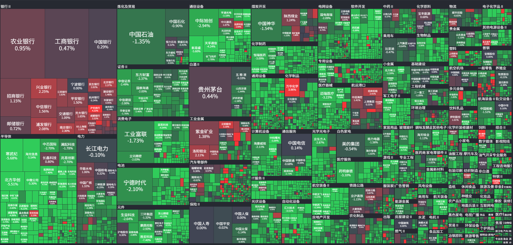

周四事儿最多。

| 10.28 周三           | 10.29 周四                 | 10.30 周五            |
| -------------------- | -------------------------- | --------------------- |
| 08:00 SK 海力士电话会 | 02:00 FOMC 公布利率决议    | 04:00 AMZN、INTC 财报 |
|                      | 02:30 沃什讲话             |                       |
|                      | 04:00 GOOGL、MSFT 财报     |                       |
|                      | 09:00 三星电子三季报电话会 |                       |
|                      | 20:30 核心 PCE 物价指数年率 |                       |

> 美联储公布利率决议
>
> FOMC 是美联储负责制定货币政策的委员会。
> 所谓“利率决定上限”，指联邦基金目标利率是一个区间。例如目标为 3.75%—4.00%，其中 4.00% 就是上限。
> 届时会公布：
>
> - 加息、降息还是维持利率；
> - 对通胀和就业的判断；
> - 后续政策可能怎样变化；
> - 委员是否存在分歧。
>
> FOMC 通常每年举行八次会议，相隔约六至八周。每次会议都会发布声明，经济预测通常每年更新四次。

> FOMC 全称是：
>
> Federal Open Market Committee
>
> 中文叫“联邦公开市场委员会”。
>
> - Federal：联邦的
> - Open Market：公开市场
> - Committee：委员会
>
> 它是美联储内部负责制定货币政策的机构，主要决定联邦基金利率目标区间，并决定是否通过买卖美国国债等方式调节市场资金。
>
> “公开市场”指美联储在金融市场买卖证券：
>
> - 买入国债：向市场投放资金，通常使金融条件变宽松。
> - 卖出或减少持有国债：从市场回收资金，通常使金融条件收紧。

> 美国9月核心PCE年率
>
> PCE Price Index 是“个人消费支出价格指数”，衡量美国居民购买商品和服务时，价格整体涨了多少。
>
> “核心”表示剔除食品和能源，因为油价和食品价格短期波动很大；“年率”表示2026年9月相比2025年9月上涨多少。
>
> 这是美联储非常重视的通胀指标：
>
> - 高于预期：通胀顽固，降息更困难，通常利空高估值科技股。
> - 低于预期：通胀降温，降息空间增加，通常利好股票和债券。
>
> PCE 数据每个月公布一次，每次公布 PCE Price Index 的 MoM 和 YoY。
> 年率就是 YoY，月率就是 MoM。
>
> 2012 年 1 月，美联储将 2% 设为长期通胀目标，衡量口径是整体 PCE 物价指数的同比涨幅。核心 PCE 剔除了食品和能源，更适合观察通胀趋势，但并不是目标本身。如果核心 PCE 年率持续高于 2%，通常会增加美联储收紧货币政策的可能性，并对美元形成支撑。

> 本周最重要的四个宏观事件是 FOMC 利率决议、半小时后的沃什讲话，以及周四晚上 8 点半公布的 GDP 和 PCE 数据。
>
> [周策略更新：破位边缘VS美联储会议 三市波段笔记@微信公众号](https://mp.weixin.qq.com/s/Ilvodua4u7l-MGpuSWbHtw)

## 2026-10-26 A 股

### 观察和总结

| 标的       | 涨跌幅 |
| ---------- | ------ |
| 创业板指数 | -1.71% |
| 上证指数   | +0.19% |
| 中际旭创   | -2.96% |
| 新易盛     | -3.57% |
| 药明康德   | +0.88% |
| 紫金矿业   | -4.58% |
| 东山精密   | -7.70% |
| 中国石油   | +4.94% |

今天药明康德港股发布财报，业绩很好。
紫金矿业和光模块继续跌。  
中国石油暴涨，从股息率上来看，已经不划算了。

[药明康德2026三季报解析 by 吕执着@雪球](https://www.xueqiu.com/5673225518/413923191)

### 今日之鉴

还是观察，看科技是如何出清，以及 CXO 在基本面右侧，股价左侧是如何走出来的。

<!--### 回顾历史-->

<!--### 经验与教训-->

### 猜测未来

美股科技股还没走出来，A 股就算表现再好也没办法。
目前唯一能看到机会的就是创新药。

<!--### 今日交易-->

### 交易计划

中国石油今年中报分红 0.26 元每股，猜测全年一股可能是 0.52 元，现价 13.38，对应股息率 3.8%，已经 price in 了太多的预期。  
我在中国石油上已经浮盈 24%，从 10 元拿到 8.5 再拿到现在，如果股价跌破 13 元我会直接清仓离场，锁定收益。现在是移动止盈阶段。

我给药明康德挂了涨停价卖出的隔夜单。财报很好，这里其实应该加仓，但是我想做 T。我觉得以 A 股这尿性，明天就算涨停也会被砸开，如果涨停后再破板，我就买回来。
美国那边也有政策风险，但我还没查清楚具体是哪个法案。

紫金矿业这个位置比较有性价比，但是需要对财报进行一番研究才能下手。

## 2026-10-26 美股

### 观察和总结

半导体反弹，Google 甚至跌回了上一次财报发布时的价位。

Anthropic 提交了招股书，要上市了。

说实话，看不懂。

### 今日之鉴

我觉得这一轮半导体走势是很好的观察样本。
雪球上也有看多和看空的，比如李智胜是看空的，认为到时候债务爆雷就完蛋了。

<!-- ### 回顾历史 -->

<!-- ### 经验与教训-->

### 猜测未来

还是要观察，有财报要等，而且还有一些利率上的会议。
我觉得应该是不会再跌了，但是我没有观察到任何迹象。
看起来像是跌透以后，在没有新消息的情况下莫名其妙止跌反转；同时，市场上唱空半导体的消息也突然少了。

### 今日交易

清仓 HDV 和 MCD，我认为红利该跌了，因为科技本身和红利就是跷跷板。
而且我本来就对 MCD 了解不多，很少吃麦当劳。

发生了一件哭笑不得的事情：本来设置了从 IBKR 转仓到嘉信证券，拿一股 HDV 试水，结果忘记了 HDV 已经被清仓。

## 2026-10-27 A 股

### 观察与总结

- 创业板：-3.41%
- 上证指数：-1.33%

熊市里，即使药明的财报非常好，也没人愿意来买，大家都在博弈。
最惨的我觉得就是科伦药业了。难怪谢潜渊说熊市只能追第一根阳线，今天科伦接近跌停。

你要是看好油价和通胀，能源化工 ETF 其实不错。

[康龙化成三季报简析 by 吕执着@雪球](https://www.xueqiu.com/5673225518/414131655)

### 今日之鉴

今天表现最好的板块是银行。难道银行在熊市里能获得超额收益？
其实并没有，2021 年 12 月银行也是跌的。

而且我发现熊市里的资金都会抢跑：哪家公司财报好，财报出来后反而直接砸盘。比如科伦药业，SKB264 数据好也没用。

可以观察一只牛股在熊市里如何表现。熊市是存量博弈，基本上大家都会提前预期财报，然后直接开始砸盘。

### 交易计划

打算清仓 520990。当时看 HIS1963 买了，以为这个东西可以当作现金用……结果今天一看，发现它纳入了长飞光纤……无语。

还是老老实实买红利低波吧，一个红利产品都能回撤这么多。要是我想配置港股，我会选择 03441.HK。

## 2026-10-27 美股

我认为美股已经调整见底。马斯克前几天说，未来很多 neo cloud 会死掉，结果 NBIS 不跌反而涨了 10%。
当时这被当作利空解读，再大的利空也砸不下去，就说明已经到底了。

但是今天最好也别买，因为还有沃什的讲话、微软和谷歌的财报。

### 今日之鉴

我觉得又是一次复盘的机会。

比如前半个月，纳斯达克在半导体带领下创新高。
然后市场跌了一点，比如那篇 OpenAI ARR 不及预期的小作文出来时，很多人（包括我）就想着回调加仓，这种想法其实出于对亏损的厌恶。
但是实际上应该止损，尤其是从高点刚刚被小作文搞下来的时候，恰恰说明这个时候筹码非常拥挤。

下跌的时候，也要判断清楚这里是不是发生了踩踏。
等到真的下跌时，说实话，我已经麻木了，基本上群聊里都没有人聊天了。

### 猜测未来

这里大概率是震荡。海力士财报超预期，还要回购。没法证伪 AI 的逻辑。

### 交易计划

META 和 GOOGLE 都跌得挺惨。
其实我也不看好他们俩，Google 出财报再说吧。

我其实觉得 HDV 和其他高股息资产应该跌了。如果科技股上涨，到时候再配置回去。

## 2026-10-28 A 股

- 中际旭创：+10.28%
- 上证指数：+0.91%
- 创业板指：+3.40%
- 康龙化成：+6.31%

应该要筑底了，当然还是跟着美股的。

这段时间行情非常无聊，因为只能等科技板块出清，然后这样大盘必然是半死不活的。
导致药子也不能涨得很好，只能看看财报。

### 经验与教训

看药明康德和康龙化成，显然药明康德更加低估，财报也更炸裂，然后康龙化成符合预期，但是估值也比较贵。  
肯定是药明康德更好，但是药明康德涨不过康龙化成，说明筹码很重要。药明康德被太多人重仓了，涨起来后，一堆机构都想卖。
可见涨与不涨，不仅仅由基本面决定，还由筹码决定。

看药明康德，从 80 元涨上来，涨幅已经很大。为什么说需要震荡来消化？因为涨了就有人想卖，尤其是科技回调时，会有基金需要调仓。

## 2026-10-28 美股

- 纳指：+0.27%
- GOOGL：盘后 -10%
- META：-1.24%

### 观察与总结

Google 财报不及预期，盘后暴跌 10%，与 MSFT 财报形成鲜明对比。

上周说的话应验了，不要买 FCF 不好的企业。META 也是同样的问题。
我还没看过 META 的财报，但是不看好任何搞发债的企业。

随着 Agent 时代的到来，Google 的搜索业务显然未来不会有很好的收益了。

Google 必须转型为以 GCP 为主的厂商，对外卖 token。因为未来大家不会在搜索引擎中敲问题，而是会去问 Agent。

所以 Google 必然会主推自己的 Gemini，问题是怎么让用户形成依赖。

大厂之间的军备竞赛还是在发力的，大家都希望有自己的云服务，然后用足够低的订阅价格配合好的 Agent 软件留下用户。

- 云侧：部署模型
- 模型：收取订阅费用
- 软件：结合模型嵌入实际工作流

Google 现在在云侧和模型侧都有优势，自己的 GCP 有 TPU，模型侧有 Gemini，但是搜索业务尾大不掉。
我还是看好 Google，但是现在买绝对是太着急了，等每个人都能够用上 Google 家的模型再说吧，显然 Google 在大模型**商业化**这个环节掉队了。  
Anthropic 有 Claude Code，OpenAI 有 ChatGPT，xAI 有 Grok，Google 始终没有拿出像样的产品，甚至可以说连腾讯都不如。

### 经验与教训

1. 别买 FCF 不好的企业。
2. 要在自己的持仓中加入防御的部分，无论是 MCD 还是 HDV。

### 交易计划

不着急买 Google，微软和谷歌的财报证明资本开支还会持续。

LITE 这笔仓位现在已经盈利，开始进入移动止盈阶段。

## 2026-10-29 A 股

### 观察与总结

- 创业板指数：-4.45%
- 中际旭创：-8.53%
- 天孚通信：-19.77%

大 A，食之无味。
可见 A 股熊市千万别追，你以为要筑底反转了，第二天直接埋了。

## 2026-10-29 美股

### 观察与总结

AMZN 和 INTC 发布财报，INTC 财报 miss，AMZN FCF 转负。

- 纳指：-1.38%
- INTC：盘后 -28.58%

录得我投资美股以来最大亏损。

清仓 LITE，锁定收益。

### 经验与教训

传 MRVL 要收购 LITE，LITE 大涨。在美股，暴涨就卖真的是胜率很高的策略。

## 2026-10-30 A 股

- 创业板指：-4.13%
- 上证指数：-1.44%
- 药明康德：-0.62%
- 康龙化成：+3.43%
- 科伦药业：+2.78%
- 凯莱英：+0.30%

出清加速。笑了，科技眼看要见底了，结果被美股带崩了。

符合我之前说的，美股走出来，A 股才会有机会，所以现在看盘，把注意力放在这些科技公司上，有点浪费了。  
等走出来再说吧。倒是一些医药公司的财报出来，可以看到医药是在反转的，而且给的估值也不低。

## 2026-10-30 美股

- 纳指：-2.86%
- MRVL：-10.05%

刷新了我投资美股以来的最大亏损纪录，
因为 Google、MRVL 和 INTC 这三只我都有。

传 MRVL 要收购 LITE，醉了。黄仁勋说，MRVL 会成为下一家万亿公司，难道是靠着发债收购其他公司成为万亿的吗？

### 今日之鉴

今日的 Google 和 Amazon 就是 CAPEX 侵蚀 FCF 的典型例子。

我也切实体会到，在半导体周期高点，任何消息都会被当成利空消息。

### 教训

估计很多人都以为亚马逊、谷歌财报出来就会涨，但是实际上还是跌了。
我也是这样认为的，结果崩了个大的。

MU 的 FWD PE 大概是 6 倍。在周期高点，看不清时最好什么都不做。
我终于知道为什么那么多大佬会配置很多指数基金，比如 VOO、QQQ 和 HDV，因为它们比个股稳健。
