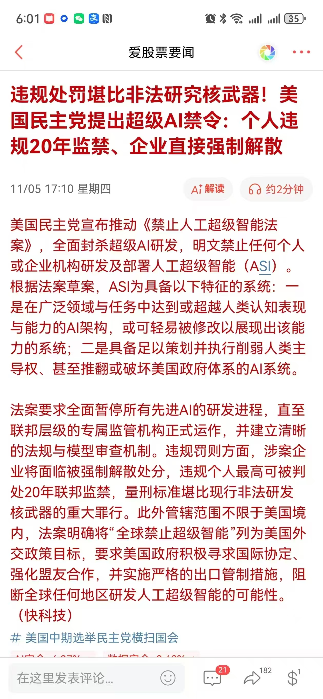
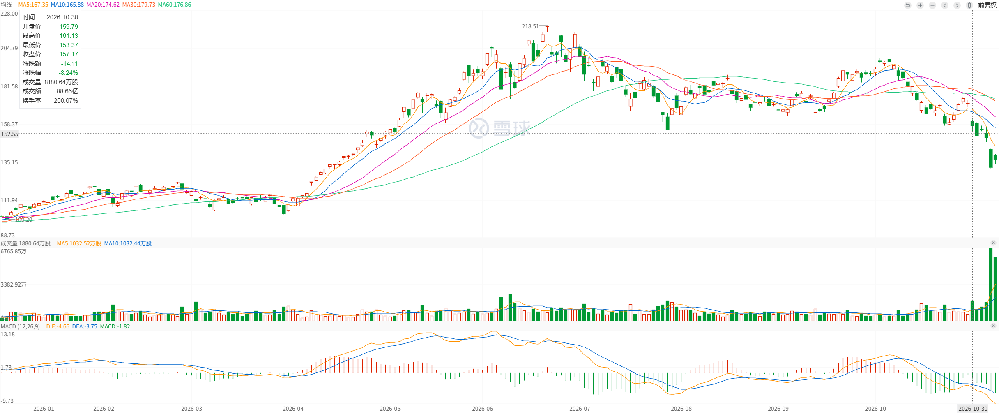

本周录得投资以来最大亏损，因为正好遇上黑天鹅。

至于黑天鹅发生的原因，有人说是民主党拿下了众议院和参议院，然后市场预期这会对人工智能数据中心建设造成重大的阻碍，导致了半导体板块的抛售。

我对此非常无语：

1. 首先，这件事完全没有前兆。在大选之前，没有任何消息提到说民主党会暂停现有数据中心的建设。这一轮下跌是从 OpenAI ARR 不及预期的小作文开始的。
2. 其次，是**中文互联网**引用的一条**旧新闻**，所谓的「禁止超级人工智能法案」，早在 9 月份就提出了。
3. 最后，从一个法案到最后的通过还有非常长的距离。

这一轮抛售潮一定有非常多的人因为上了杠杆然后被强平了，我推测链条是这样的：

1. 对于美国人，民主党上台已经被 price in 了
2. 数据中心建设被暂停压根没人考虑过，否则之前 Google 财报在跌啥呢？不就是担心数据中心开支吗？怎么那个时候没说：
   **「没关系，民主党会拿下众议院和参议院，这个数据中心会被暂停的，放心吧，你再多的 CAPEX 也会喊停的」**
3. 但是中国人不知道，最近流传的小作文就是，民主党要暂停数据中心建设，然后中国人就开始砸盘，这小作文还是 9 月份报道的中文新闻
4. 中国人砸盘叠加之前半导体板块尸横遍野，触发 margin call，大家一起爆仓
5. 实际上屁事没有，最后大家还是要买回来，无非是拥挤了，一个超出所有人预料的小作文干碎了大家

大概率是之前有人看要到底部了，难道市场比 7 月底那个时候还要差？于是有人开杠杆做多。然后中国人抛售，然后又引发了一轮爆仓。

注意本来在 10 月 23 日已经有反弹的迹象了，但是 10 月 29 日没冲上去，然后一路直下。

### 经验和教训

本周的经验和教训有：

1. 在下跌的过程中抄底也要耐心，不要着急抄底，同时心理层面要有预期
2. 远离并购的企业，MRVL 收购 LITE 导致二者股价陷入死亡螺旋，这类股票不是首要抄底对象
3. 关注 VIX 指数，可以通过观察 VIXY 的走势来判断风险，决定仓位，甚至做好对冲
4. 远离熊市下机构重仓的股票，如药明康德、MU、LITE、中际旭创等
5. 熊市的反转先是政策底部，然后再是价格的底部

我的问题是：如何在下跌的过程中设置好止损并抄底？

假设自己本来就有仓位，然后下跌得非常厉害，你认为是错杀，你会怎么做？

- A. 一刀剁了
- B. 越跌越买
- C. 买一点，然后看情况不对马上卖掉

我认为，首先要控制仓位。因为你认为市场是错杀的，但是真的吗？  
margin call 下，底部是未知的，市场非常恐慌，如果一直没有正反馈，会剁到**所有人都怕了**为止。  
但是博弈的点在于，随时可能反弹，存在极高的**不确定性**。

而投资要遵循的一点是：**不确定性越高，仓位越低**。

这个时候，先远离风暴中心的股票，比如业绩 miss 的 INTC、打算收购 LITE 的 MRVL，这些股票要一刀剁掉。
要知道 SOXX 本周下跌了 13%，而 MRVL 下跌了 28%！  
然后是买入 VIXY 保护自己的头寸。我认为也不能去做空 MRVL，因为做空个股风险实在太大，但是买入 VIXY 的亏损有上限。

如果抄底，底部在哪里也完全不知道，但是反弹是一定有阳线，所以**看到阳线再抄底**的确定性会更高。  
因此不要开盘马上抄底，等盘中以及盘后再决定要不要抄底。  
同时反弹相对于原来的抛售都是很弱小的，这个时候不要去看支撑位抄底。

我不建议买入以后剁掉，因为你既然来抄底了，就做好被埋的准备，除非基本面完全恶化，预期变成了现实，那你再剁掉，为认知买单。  
但是如果你是来博一个反弹的，那么也是在看到阳线以后买入，然后设置好止盈和止损。  
因为来博一个反弹和价值持有是两码事。

### 下周判断

至于下周的行情，我认为应该继续抄底，但是要更加谨慎地抄底，重点是 TSM 和 NVDA，但是要按照上面的计划：

1. 观察反转是否会发生，再这么跌下去就太无厘头了，因为一个现在还不确定的政策把美国人养老金跌没了
   要知道之前关税战跌完大家才知道是黄金坑，你觉得特朗普关税和数据中心停止建设哪个更难预料结果？
2. 耐心等待，等阳线再买入
3. 如果反转发生，观察最强势的股票，我判断会是 COHR、AMD、AMZN、GOOGL 和 TSM，要抄底优先考虑砸不下去的那些，  
   而不是说看起来很便宜的那些，比如 MRVL、LITE 和 MU

同时这次下跌我们要观察到：

1. 在 SOXX 暴跌的那天，AMZN 和 GOOGL 其实是没有怎么跌的，说明不拥挤
2. 周四暴跌，周五 COHR 和 AMD 还拉回去了。像 MU 和 NVDA 是无法突破周四暴跌那天的最高点的。

本周犯下一个重大错误，就是直接清仓了 HDV，因为我以为半导体会反转，实际上，永远应该有红利的配置。  
因为其实最后的钱都是要落到红利上，因为红利会实实在在地永续经营然后分红。

改变世界的公司就是投资中的矛，不会被世界改变的公司就是投资中的盾。  
前者的 PE 很高，因为有爆发的增长力，后者的 PE 高因为有很强的确定性，可以按照永续经营来估值。  
比如前者就是 Google、SpaceX 这类公司，后者就是像 Costco、可口可乐这类公司。  
我们在前者上赚了很多钱，需要平衡到后者，让它源源不断造血，补充我们的现金流。

最后是备份一篇谢潜渊的文章：
