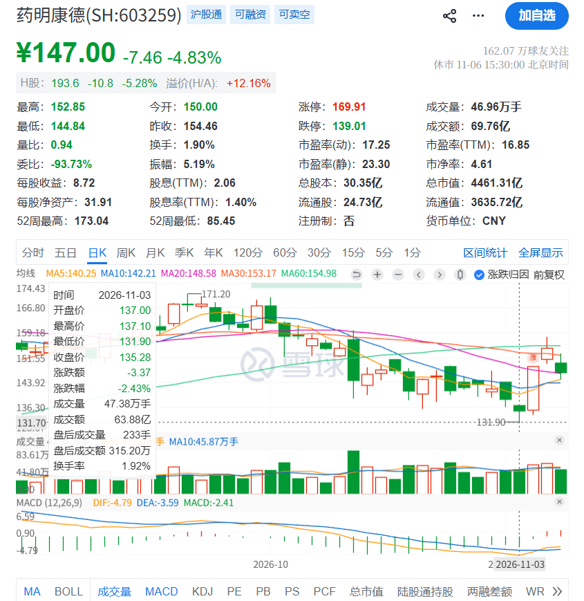

## 2026-11-02 A 股

- 创业板指：+1.87%
- 上证指数：+1.08%
- 药明康德：-2.37%
- 紫金矿业：-2.75%
- 中际旭创：-0.54%

虽然市场普涨，但是行情没啥意思，想买的股票还没到击球区。没有任何交易。

### 交易计划

中国海洋石油上周末出财报了，计提一笔 72 亿元的减值，我没仔细看财报，但是股价已经说明了一切。

简单来说：中国海油的不确定性上升了。

减值我认为不是问题，但是有些东西是不能忍受的，比如财报披露的细节，或许未来会好，但是我为什么要赌未来可能会好，而不去直接找一个未来一定很好的呢？

> 说完这5个风险，我想大家应该已经明白“为啥中海油的三季报不及预期”了吧。其中产量增速不及预期和人民币贬值主要影响了收入增速，桶均主要成本和资产减值主要影响了利润增速，披露信息的粒度变粗则影响了我们分析财报的准确性。
>
> [中海油2026年三季报 - 集中暴露了一波风险](https://mp.weixin.qq.com/s/KeR3oYgJ-zMZ36FZLRsLeA)

## 2026-11-02 美股

**继 INTC 后，MRVL 和 LITE 陷入死亡螺旋**

- MRVL： -12.72%
- QQQ：-1.36%
- VOO： -0.50%
- HDV: -0.16%

屋漏偏逢连夜雨，最近感觉被美股追着杀，先是 Intel -30%，然后 MRVL 要收购 LITE，三天又跌了30%。
加上之前的 NBIS，我在三个股票上吃满了 30% 的跌幅，如果 LITE 没清仓，还得接着亏……

今天将 Intel 换一半到 AMD，又被杀 7%…

BTW，美股也有一天杀一只白马祭旗的传统吗？

### 经验与教训

炒股多年从未经历过这种事情，手里的持仓竟然能有三个票吃到 30% 的跌幅！可见分散配置的重要性。

MRVL 说收购 LITE，一股 LITE 相当于 4.5 股 MRVL。
MRVL 股东权益被稀释，立刻下跌，MRVL 股价下跌，LITE 相当于 4.5 股 MRVL，于是跟着一起跌，然后两边陷入左脚踩右脚死亡螺旋。

我们其实是没法预测市场怎么变化的，要是在牛市，LITE 和 MRVL 这两个消息出来我认为影响会比现在小很多。

### 操作计划

会继续买入 MRVL 和 LITE，如果 Marvell 收购成功，股权稀释的同时也会获得 Lumentum 的市值，长期看是利好，更别说收购还不一定会被通过。  
参考：[关于Marvell收购Lumentum的初步看法by雪中滚雪球@substack](https://substack.com/home/post/p-223179691)

MU 快要下跌到 800 美元以下了，TSM 已经到了 400 美元以下，再跌会按照计划加仓，会把 NBIS、INTC 和 RKLB 换到这些公司。

## 2026-11-03 A 股

**国家队强力出手，暂停 IPO**

- 创业板指：-2.73%
- 上证指数：-0.82%
- 药明康德：-2.43%

今天的市场参考：[打疯了，枪管都打红了 by 猫笔刀@微信公众号](https://mp.weixin.qq.com/s/7Jwg-3AsvYihUuGczBbkig)

### 经验和教训

其实我最纠结自己为什么无法做到在药明康德下跌到 140 多的时候没有及时减仓。  
首先我不减仓的原因是，我觉得药明康德很便宜，药明我认为 140 多，也就是大约 12x fwd PE 的情况下，我可以再承受 20% 的回撤。  
虽然我拿的住药明康德，但是我感觉有做 T 的机会没抓到，就会比较心疼。

如果我想要减仓，唯一的原因就是：大盘不好，药明技术面很差。
那我要如何预先识别出这种信号呢，现在看来的方法就是识别支撑位，如果技术面很差以及大盘熊市的话，破了支撑就要减仓，站稳支撑再加回来。

所以：公募重仓 + 熊市 + 技术面差 = 卖出

## 2026-11-03 美股

### 今日操作

NBIS、INTC 换成 MU、MRVL 和 LITE。

## 2026-11-04 A 股

**大奇迹日，药明康德涨停**

- 创业板指：+6.40%
- 上证指数：+2.16%
- **药明康德：+10%**
- **凯莱英: +10%**
- 中际旭创：+11.07%
- 紫金矿业：+6.56%

### 经验

我们要注意的两个问题是：

1. 这次见底之前，有什么信号吗？
2. 如果真的见底了，应该做什么方向？

我的观察是，前一天出政策啥的。比如不让 IPO 了，让企业回购，然后美股那边大概是大选还没有结束，但是快要出结果了，不确定性都下降了，就涨。

这是我的解释，可以看到见底是有信号的，没人可以预判底部在哪里，但是可以判断底部是不是越来越近了，这次可以观察到的信号：

1. 政策底部：暂停 IPO，支持企业回购
2. 国家队大量买入，从白天买到下午，一副这里就不能跌下去的样子

可以说，随时都可能反弹，只需要一个**重大的事情**来决定了方向。

最重要的是，看今天涨停的股票，因为强势股在大盘反转的时候会涨停，CXO 一哥今天直接涨停。

### 今日之鉴

看到谢潜渊的公众号文章：[见底了](https://mp.weixin.qq.com/s/Xqgbwc65VT8LDyb3vvVmmA)

药明康德虽然在不断下跌，但是 10 月 16 日、22 日、27 日以及 11 月 2 日下跌的幅度在逐渐的收窄，  
并且跌幅从一开始的 6% 通过 3 周左右的时间，跌幅收敛到了 2%，MACD 线也在 11 月 3 日出现了转折。

而凯莱英比药明康德止跌的时间更早。

### 交易计划

对比了几家创新药 ETF 的持仓，

- 港股通创新药医疗ETF富国(SZ:159506)：[持股明细](https://fundf10.eastmoney.com/ccmx_159506.html)  
  前五持仓：百济、信达生物、石药集团、康方、金瑞斯
- 港股创新药ETF银华(SZ:159567)：[持股明细](https://fundf10.eastmoney.com/ccmx_159567.html)  
  前五持仓：康方、百济、石药、中国生物制药、信达
- 港股创新药ETF广发(SH:513120)：[持股明细](https://fundf10.eastmoney.com/ccmx_513120.html)  
  前五持仓：药明生物、百济、信达、药明康德、石药集团

最重要的区别是，513120 有 CXO，如果全是 biotech 就和赌博无异了。  
以前不懂事，持有前两者，后续会切换到后者，并且开始定投。

## 2026-11-04 美股

**民主党横扫了费城半导体**

- GLD: +3.68%
- QQQ: +0.97%
- VOO: +1.62%
- AMZN: +6.12%
- NVDA: -3.17%
- SOXX: -3.14%

Amazon 是最亮的仔，但是半导体还是半死不活。AMD 炸裂的财报也救不回来。

民主党拿下了众议院和参议院，其实涨的最好的是医疗、光伏这些板块，黄金跳空上涨。

市场在交易「Blue Wave」，就是民主党会反对数据中心的建设，然后半导体板块继续回调。

### 今日之鉴

我觉得确实是一个观察半导体会怎么走的非常好的样本。  
到底是周期行业明日黄花，还是极致情绪下的错杀。

### 今日交易

加仓了 QQQ 和 AMD。

### 经验与教训

美股现在的波动越来越大，**拥挤**的板块基本上**不见血**买入都会承受**极大的波动**。  
而且就算见血了，也不知道这里到底是不是底部。要是明天再来一个新闻说什么 OpenAI 不及预期，估计又要爆炸。

而且我忽视了短期重大事件对市场的影响，虽然长远来看都是波动，但是短期来看真的很刺激。

### 交易计划

会继续加仓 MU、TSM 和 AMD。

## 2026-11-05 A 股

- 上证指数：+0.10%
- 创业板指：+0.87%
- 中际旭创：-7.51%
- 药明康德：+3.80%
- 紫金矿业：+0.79%
- 半导体设备：+9.15%

我觉得是盘面非常无聊的一天。CXO 的筹码比算力板块好得多，而且美国那边算力还跌出屎来，现在买算力相当于逆风局。

我要买 A 股的算力链条，为什么不买美股的呢？

### 今日交易

清仓了中国石油和能源化工 ETF，浮盈很多，奈何买入很少。

## 2026-11-05 美股

**莫名其妙的暴跌**

完全不知道为什么暴跌那么多，就算说民主党阻挠数据中心建设，也不至于都停了吧，而且还是中文互联网流传的旧新闻。

我怀疑就是踩踏了，中国人剁出来了，美国人跟着剁。

### 经验与教训

LITE 和 MRVL 买入的太着急。所谓「君子不立危墙之下」，原来说的是这个道理。

我见过 Google 和 Oracle 财报出来暴跌或者暴涨，然后过几天再暴力反转。
但是我第一次见到并购的消息，它和财报不一样，会锁定并购双方的价格，导致同涨同跌。

我们都知道如果被错杀了是非常便宜的，而且我认为大概率被错杀了，因为 AI 的发展还是需要这些的。

这就涉及到一个问题：**什么时候对抗市场的主流叙事，什么时候去顺应市场的主流叙事**。
我们很难判断市场的主流叙事会持续多久、什么时候反转，尤其是非常拥挤的地方，判断的难度会显著上升。
你不知道这里有多少人上了杠杆，要爆仓到什么时候，所有的支撑位在拥挤面前都像纸糊的一样。

所以最优的做法应该是直接清仓 MRVL 和 LITE，而不是认为太便宜了我要买。
就算要抄底，也要评估这里的拥挤程度，然后抄底的资金要小，甚至有必要的话，设置好止损。

此外，今天发现一个标的叫做 VIXY，感觉会更加灵敏，比如这次 10 月初纳指的暴跌，从 VIXY 的走势上或许可以预测。  
至少在 VIXY 开始走出上升趋势的时候，不要加仓而是应该减仓。

### 今日操作

卖出 NBIS 和 RKLB，换到 TSM 和 MU、NVDA。

## 2026-11-06 A 股

**光又被美股带下去了**

- 上证指数: -1.10%
- 创业板指: -3.96%
- 红利低波: +1.05%
- 药明康德: -4.83%
- 凯莱英: -3.98%
- 康龙化成: -8.18%
- 科伦药业: -0.33%
- 中际旭创: -9.19%
- 新易盛: -7.28%
- 紫金矿业: -4.07%

创业板被昨天的美股带下去了，医药的调整显著小于科技。

我觉得今天盘面很无聊，就是震荡，科技还是不用看了。中际旭创两天接近 15% 的跌幅，啧啧。

我听说有些私募今天不让净卖出了，所以我认为大 A 真的到底了。

### 交易计划

药明康德开始做 T，我认为这里会是一个复杂的底部，大盘估计不太可能新低了，计划是如果涨了就卖，跌破了 140 就买入。

## 2026-11-06 美股

**半导体反弹，但是不够强**

- 纳斯达克: 1.09%
- 标普500: 0.31%
- 短期期货波动ETF-ProShares: -0.90%
- 核心高股息ETF-iShares: -0.69%
- Rocket Lab: +15.39%
- Coherent Corp.: +13.58%
- AMD: +11.04%
- 台积电: +6.33%
- 迈威尔科技: +5.73%
- Lumentum: +5.67%
- 高通: +5.52%
- 美光科技: +5.12%
- 英伟达: +2.78%
- 谷歌-C: +0.78%
- 博通: +0.74%
- 亚马逊: -0.35%

谢潜渊认为现在没得看，而且也不应该抄底，因为在整个局势没有明朗以前，不值得去加仓。
什么叫做局势明朗，就是民主党需要表态要不要数据中心建设。

### 猜测未来

这一轮是 margin call 触发的链条，我猜测是这样的：

1. 对于美国人，民主党上台应该被 price in 了
2. 数据中心建设被暂停压根没人考虑过，否则之前 Google 财报在跌啥呢？不就是担心数据中心开支吗？怎么那个时候没说：  
   **「没关系，民主党上台，这个数据中心会被暂停的，放心吧，你再多的 CAPEX 也会喊停的」**
3. 但是中国人不知道，最近流传的小作文就是，民主党要暂停数据中心建设，然后中国人就开始砸盘
   这小作文还是 9 月份报道的中文新闻
4. 中国人砸盘叠加之前半导体板块尸横遍野，触发 margin call，大家一起爆仓
5. 实际上屁事没有，最后大家还是要买回来，无非是拥挤了，一个超出所有人预料的小作文干碎了大家

### 经验与教训

一个板块的见顶到触底可以观察到：

1. 从顶点开始回撤，有人说别慌
2. 继续下跌。风声鹤唳，各种消息出来都是利空，任何好消息都带不动上涨。
   有人开始抄底，但是直接被埋，下跌非常流畅
3. 跌幅收窄，横盘。好像暂时停住了，但是还是不确定是否反转
   又有一堆人抄底进来，而且可能还是带着杠杆的
4. 止跌的必要条件：
   1. 估值绝对便宜
   2. 杠杆被杀干净了
   3. 开始出现明朗的新闻或者政策
5. 止跌的特点：
   1. 好消息带动上涨
   2. 坏消息反而不砸盘
   3. 强势股涨得比大盘还多

现在我猜测在 3。

这次抄底，我认为我属于被埋了的那一批。跌幅远超想象，因为周期股定价是非常恐怖的，比如 MU 从 6 PE 到 4 PE，会跌去 30%！  
悲观情况下 MU 跌到 3x PE 我认为都有可能。
