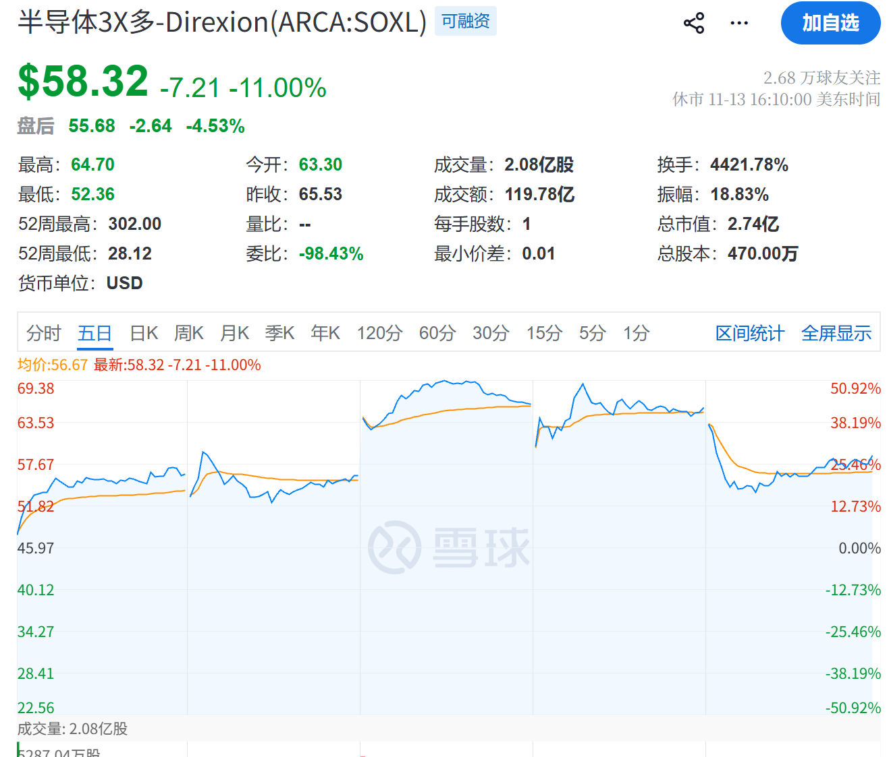
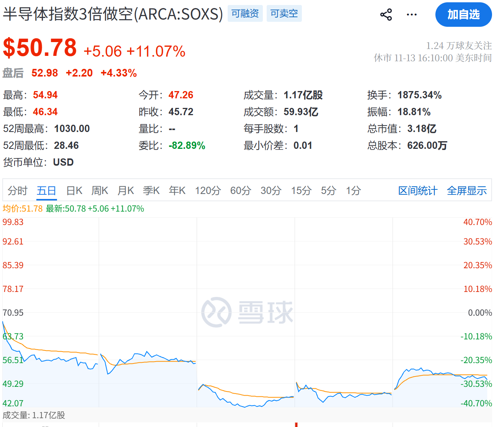

# 2026-11-14 周投资复盘

## 本周行情速览

- QQQM: +3.61%
- SPYM: +2.55%
- SOXX: +9.35%
- 上证指数：-0.41%
- 创业板指：-1.59%

从整周表现看，本周是半导体反弹周，但期间也出现了剧烈波动。最大的利空是黄仁勋离职，这里不讨论离职的原因。

我的理解是，英伟达为很多 AI 项目的债务提供了支持。黄仁勋离职，会让市场质疑英伟达投资的 AI 产业链能否持续发展，进而拖累半导体板块，也带崩了中国的英伟达产业链。

## 本周交易复盘

1. 清仓中国海洋石油
2. 将部分创新药 ETF 持仓切换到 513120
3. 卖出大量英伟达，留下 0.9 股
4. 买入 LITE、GOOG、COHR 和 AMD
5. 在 AMD 反弹时清仓
6. 赌 NBIS 财报

周一清仓中国海洋石油的操作是正确的。原因上周说过：我对公司财报失望，不确定性也在上升。

接近清仓英伟达也是正确的，属于回避风暴中心的操作。

## 做得不好的交易

本周做得很差……我的感悟是，自己目前的收益更多来自**对市场博弈的判断，以及对人性的把握**，企业增长带来的收益反而没有那么多。

1. 没有为 COHR、LITE 等持仓设置追踪止损，及时保护利润。
2. 赌 NBIS 财报，被迫止损 20 个点。

我发现自己的交易都在晚上，而我晚上更容易冲动，做出不理性的决策。

具体表现为 FOMO 和接飞刀。折腾下来，又为 IBKR 贡献了不少手续费。

## 错过的机会

围绕 NVDA 的博弈，以及做空 NBIS，都是我错失的机会。

我第一次遇到黑天鹅如此密集出现的行情。不过，我认为 chaos is a ladder：混乱也可能带来机会。

不要低估政治权力变化对股市的影响。不能以为民主党拿下两院就尘埃落定，实际上还伴随着对共和党的清算。

在这种大涨大跌的行情中，我观察到，三倍做多半导体 ETF（SOXL）和三倍做空半导体 ETF（SOXS）开盘后形成的趋势，往往会延续一段时间。这两只 ETF 分别以半导体指数单日涨跌幅的三倍和反向三倍为目标。

如果在 OKX 平台交易，我想到的策略是：开盘后先观察 1 分钟的走势，再选择方向，配合止盈止损订单，或许有机会。

如果可以不隔夜，最好就不要隔夜，利用当天买入后可以当天卖出的 T+0 交易机制。

## 下周的预判和计划

我估计还是没有好的机会，因为整个市场笼罩在不确定性之中。
民主党会采取什么政策，英伟达的财报表现如何，都还没有定论。

A 股还是只看创新药，以及一些高股息周期股。先研究，再决定要不要动手。

我已经将大量持仓转到了嘉信证券，因为 IBKR 的手续费太贵。

接下来应该仔细看财报。纳斯达克已经开始修复，我判断，如果民主党释放一些利好，市场还会涨起来。

同时需要研究嘉信证券的下单方式，为交易设置止盈和止损，并用 OCO 将两个退出订单关联起来：一个成交，另一个就取消。如果想在盈利后按回撤幅度退出，还需要设置追踪止损。
