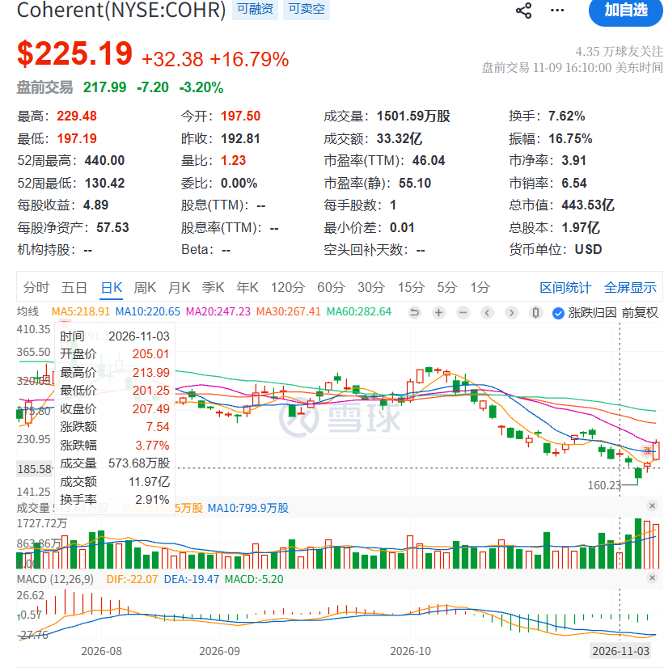
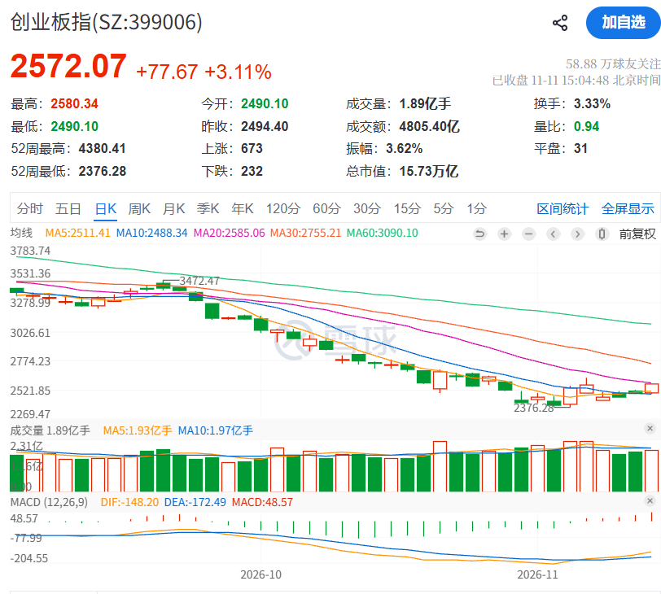

## 2026-11-09 A 股

- 上证指数: +0.32%
- 创业板指: -0.27%
- 红利低波: +0.41%
- 药明康德: +2.24%
- 凯莱英: -3.09%
- 康龙化成: -3.03%
- 科伦药业: -1.84%
- 中际旭创: +0.90%
- 新易盛: +2.27%
- 紫金矿业: +0.46%

减量博弈，没啥意思的行情。

### 今日交易

- 清仓中国海洋石油
- 创新药 ETF 部分切换到 513120

## 2026-11-09 美股

**黄仁勋承认婚外情，半导体大反弹**

11 月 9 日早上起床看到黄仁勋的这则消息，我立刻清仓了所有 NVDA 的仓位。  
被 MRVL 和 LITE 整得害怕了，远离风暴中心，除非走出来，否则我不会买入。

- 纳斯达克 +2.74%
- 标普500 +2.35%
- 短期期货波动ETF-ProShares -13.41%
- 费城半导体ETF-iShares +7.49%
- 核心高股息ETF-iShares +0.66%
- 英伟达 -4.27%
- 亚马逊 +2.94%
- 台积电 +3.51%
- 谷歌-C +0.73%
- 迈威尔科技 +9.49%
- Lumentum +10.69%
- 美光科技 +6.25%
- 高通 +3.66%
- Rocket Lab +10.91%
- Coherent Corp. **+16.79%**
- 超威半导体 **+13.26%**
- 博通 +8.78%

### 今日之鉴

今天的反弹我认为从消息面上完全没有人可以料到的。  
因为没有任何好消息。唯一能观察到的现象是，上周五晚上公布了非农，是利空的，但是市场没有下跌反而还上涨了，然后周一开始大反弹。

猜测这就是下跌趋势中一种利空出尽算利好？
因为美国的经济一直都很强劲，如果经济不错，对股市也算一个好消息，因为大家都有钱消费了。

### 经验

上周我的复盘文章中提到，COHR、AMD 在这轮下跌中更加抗跌，果然今天反弹明显也比其他更强。  
但是对于 timing 的时机要把握好，如果在 11 月 3 日买入，会跌 20%，反弹要趁着阳线买，接飞刀绝对不可取。

### 交易

买入 LITE、GOOG 和 COHR。  
因为 LITE 和 COHR 已经腰斩了，而且我认为今天利空出来还不砸，就是说明砸不动了，已经到底了。

### 交易计划

我觉得应该开始考虑买入 AMZN、GOOGL 和 META 这些公司了，因为算力中心会持续盈利。  
随着 CAPEX 到达顶峰，那么数据中心的成本是可以逐渐收回的，而 Google 等公司这一波已经被砸得很惨了，市场已经 price in 了 CAPEX 导致的自由现金流的流失。
而随着民主党上台，这个数据中心的建设会更加可控的发展，大厂的 CAPEX 不会再像之前那样扩展了，这是我的预期。

## 2026-11-10 A 股

- 上证指数 +0.08%
- 创业板指 +1.46%
- 红利低波 -0.42%
- 药明康德 +0.01%
- 凯莱英 +1.01%
- 康龙化成 +1.55%
- 科伦药业 -0.29%
- 中际旭创 +4.20%
- 新易盛 +4.43%
- 紫金矿业 -0.81%
- 中国石油：-6.34%

还是非常无聊的盘面

### 经验

昨晚药明康德被移出了 1260H 清单，今天高开然后被砸盘，直接从 157 砸到了 150，**高开必卖**的祖训还在发力。

值得表扬的是之前清仓了中国石油、能源化工ETF和中国海洋石油，做得非常好，人多的地方，图坏了直接走就好。

### 交易计划

云铝和神火今天大跌，不知道发生了什么事情，打算研究一下这两家公司，或许是一个买入的机会。

## 2026-11-10 美股

**CPI超预期，半导体涨跌不一**

美股公布 10 月季调后 CPI 月率，通胀超预期。

- 纳斯达克 -0.74% $25,065.87
- 标普500 -0.38% $7,520.93
- 短期期货波动ETF-ProShares -0.27% $18.16
- 费城半导体ETF-iShares -0.12% $146.59
- 核心高股息ETF-iShares +0.23% $30.62
- 英伟达 -5.47% $168.89
- 亚马逊 +1.48% $270.87
- 台积电 +2.02% $396.48
- 谷歌-C -0.38% $284.92
- 迈威尔科技 -0.14% $154.39
- Lumentum -1.78% $585.57
- 美光科技 -1.10% $725.11
- 高通 +1.20% $173.53
- Rocket Lab +6.54% $62.71
- Coherent Corp. -4.68% $214.66
- 博通 +3.91% $331.98
- 超威半导体 +1.30% $515.21

但是开盘半导体还是非常猛，AMD 甚至大涨 6%，但是盘中跳水。
TSM 还是非常稳，曾经最低 350，没几天就回到了 400 元。

虽然通胀超了预期，但是半导体板块还是没怎么下跌。

### 经验与教训

昨天追的 LITE 亏了 5%，可见虽然涨了 22%，也不能追高。

一定要设置好止盈止损单子，比如我 AMD 516 的成本，昨天 520 打到我就止盈了。
现在买入就是右侧买入了，性价比不高。 AMD 的 fwd EPS 16，400 元的时候 25x PE，480 的时候 30x PE，这个时候入手还不错。

这种股票的波动巨大，因为是 PE 的压缩，PE一旦压缩都是 5x 起步的，简直是按红利股或者周期股来估值。

### 今日之鉴

在观察这个板块是如何走出来的时候，我发现之前是小道消息出来，砸盘最厉害，等到真的通胀数据出来，反而不砸盘了。

但是现在还是不能确定半导体板块是否走出来了，因为还是处于下跌趋势中。

我们观察到坏消息出来，如果砸不动，就可能有反弹。

## 2026-11-11 A 股

**重新站在光里**

- 上证指数 +0.46% ¥3,680.64
- 创业板指 +3.11% ¥2,572.07
- 红利低波 -0.58% ¥11,233.01
- 药明康德 -1.06% ¥148.70
- 凯莱英 +0.36% ¥152.30
- 康龙化成 -2.19% ¥44.20
- 科伦药业 -0.86% ¥43.74
- **中际旭创 +15.07% ¥542.00**
- **新易盛 +16.97% ¥215.00**
- 紫金矿业 -1.14% ¥27.86
- 港股创新药ETF广发 -1.34% ¥1.26
- 云铝股份 -1.31% ¥23.41
- 药明合联 -1.50% ¥72.05
- 康龙化成 -1.26% ¥29.68
- 南方东西精选 -0.07% ¥14.06
- 康方生物 -0.56% ¥88.60
- 中国海洋石油 -0.18% ¥22.72
- 腾讯控股 -1.96% ¥409.60

算力又虹吸了整个板块，创业板指数做了一个双底出来，应该是见底了。

首先，没有增量资金愿意进来，大资金一定是缓缓的进场。
然后在散户非常热血沸腾的时候悄悄离场，然后在散户绝望的时候，开始慢慢进场捡尸体。

所以在存量博弈的情况下，大家都想要抄底算力，那么，医药如果涨上去，就会有人减仓去买科技。
所以现在医药和科技还是跷跷板。

### 今日之鉴

双底值得关注
还有 A 股在垃圾时间都是游资的天堂，涨的都是一些垃圾。

### 交易计划

打算开始加仓通信 ETF，小仓位尝试，并设置止损。
但是先观察，现在直接买等于 FOMO

### 猜测未来

我觉得还是需要关注 周五美国的 PPI 数据，但是应该不会更差了，因为真的砸不下去了。
美国现在最大的风险还是民主党的政策

## 2026-11-11 美股

美股盘前非常火热，有人说反转是 CRWV 财报超预期。
who knows

- 纳斯达克 +1.60% $25,466.19
- 标普500 +1.31% $7,619.38
- 短期期货波动ETF-ProShares -6.77% $16.93
- 费城半导体ETF-iShares +6.01% $155.40
- 核心高股息ETF-iShares +0.39% $30.74
- 英伟达 +2.87% $173.73
- 亚马逊 -1.74% $266.17
- 台积电 +4.25% $413.35
- 谷歌-C +2.00% $290.63
- 迈威尔科技 +9.33% $168.80
- Lumentum +10.67% $648.06
- 美光科技 +11.89% $811.30
- 高通 +1.75% $176.57
- Rocket Lab +5.49% $66.15
- Coherent Corp. +9.25% $234.51
- 博通 +3.99% $345.22
- 超威半导体 +7.32% $552.90

市场的广度在逐渐恢复，但是是否反转仍然未知。

## 2026-11-12 A 股

- 上证指数 -0.67%
- 创业板指 -2.44%
- 红利低波 -0.08%
- 药明康德 +1.10%
- 凯莱英 +0.25%
- 康龙化成 -0.09%
- 科伦药业 -0.69%
- 中际旭创 -6.11%
- 新易盛 -4.38%
- 紫金矿业 -3.88%
- 港股创新药ETF广发 -0.32%
- 云铝股份 -0.43%
- 药明合联 +0.07%
- 康龙化成 +0.61%
- 南方东西精选 +0.00%
- 康方生物 -3.33%
- 腾讯控股 -2.64%

昨天追科技的今天一定被套了。
可见大涨不要 fomo，A 股不是美股。

港股依旧是路边一条。

## 2026-11-12 美股

**黄仁勋辞职**

- 纳斯达克 -0.39% $25,366.09
- 标普500 -0.35% $7,592.40
- 短期期货波动ETF-ProShares +3.43% $17.51
- 费城半导体ETF-iShares -0.26% $154.99
- 核心高股息ETF-iShares +0.03% $30.75
- 英伟达 -4.34% $166.19
- 亚马逊 +0.48% $267.44
- 台积电 -1.90% $405.49
- 谷歌-C +1.62% $295.35
- 迈威尔科技 -2.58% $164.45
- Lumentum -3.61% $624.65
- 美光科技 -1.59% $798.44
- 高通 +0.32% $177.14
- Rocket Lab -3.14% $64.07
- Coherent Corp. -1.04% $232.08
- 博通 +5.54% $364.36
- 超威半导体 +5.86% $585.30

半导体涨跌不一，利好 AVGO、AMD 和 Google。

### 经验与教训

trading rule: **堵财报切忌追涨**

看到 CRWV 的财报不错，带着 NBIS 涨的很好，我也追进去。

结果 黄仁勋 辞职叠加 NBIS 财报指引改到下沿，NBIS 暴跌。

NBIS 的财报赌输了，亏了 86 USD，大概 560 RMB。

trading rule: **趋势交易要设置止盈和止损**

我认为作为一个趋势交易者是可以去追 NBIS 的，但是我们需要一个策略。
需要设置好止盈和止损。
比如 100 买入，我们应该设置一个 90 元的止损。
然后如果盈利了，那么当盈利回撤了一个阈值，就要卖出。

这样买入的逻辑就是，我认为动量会持续。

trading rule: **回避不确定性，观察趋势再出手**

开盘后，NVDA 股价反弹，空单浮盈大幅回吐，我随后平仓止盈

发现一个交易相关的技巧，NVDA 在开盘后暴跌到 148，然后被迅速拉升到 160，  
可见其实大家都是有一个心理关卡的，然后 NVDA 非常便宜，明年 fwd PE 大概 10x。  
150 美元和 10 倍 PE 都是一个关口，如果可以守住，应该做多而不是做空。

我发现做交易的话，以下几点非常重要：

1. 不要在临近开盘前去做，因为这个时候已经 price in 了
2. 要挑选一些关键的节点，比如整数节点，结合估值
3. 观察开盘后的现象决定要做多还是做空

黄仁勋辞职的消息是 09:50 左右发布的，然后 英伟达股价盘前快速下挫。
到开盘时候，还是瀑布，但是越临近开盘，**不确定性是越高的**，因为有很多人要下注，你不确定是有人要抄底还是砸盘，各有各的理由。

有人认为利空出尽反转，会来抄底，确实这样，黄仁勋走了以后，应该就再也没有负面消息了。
有人认为破位要抛售，因为黄仁勋走了，英伟达的战略都会受到影响。

一个交易员要回避不确定性高的地方，然后观察趋势，再作出决定。
像昨天，交易员观察的应该是 开盘后，英伟达股价的走势，因为要抛售的人一定是开盘立刻砸盘，但是还有人要抄底，抄底的人不一定是开盘抄底，从开盘到收盘抄底的人都有。

所以应该观察开盘后英伟达的走势，如果开盘后能拉回来应该做多，因为最大的抛压已经结束了。

再比如 NBIS，如果我们奉行不要追涨的策略，耐心等待财报公布，然后观察趋势。
我们会看到 09:00 盘前对 NBIS 财报是不满意的，这个时候可以开空单，但是到了盘前需要平仓，
因为虽然**开盘后一定有人要砸盘兑现利好**，但是 NBIS的财报也没有那么差，存在不确定性。

所以正确的做法是观察开盘后的现象，开盘其实是必然有抛压的，因为堵财报的人都走了。然后观察是否出现反转。

**不要看到有人 FOMO 就去追涨，而是要耐心等待一个做空的机会**

不要押注市场的单一走势，而是依据观察到趋势，思考背后的原因，然后出手，

同时，也可以看到做人的道理，**不要和政治走的太近**，专注地做好自己的事情。

黄仁勋和特朗普走的太近了，据说显卡走私链是特朗普儿子负责的，然后民主党想要黄仁勋做证人，但是黄仁勋不从，被迫爆出绯闻辞职。
真实性不知道，但是和一个疯子走太近总是不好的。

### 今日之鉴

遇到有 CEO 管不住自己下半身，立刻清仓。

可以看到之前的交易做得非常正确，立刻清仓 NVDA，远离风暴中心。
并做空对冲。

## 2026-11-13 A 股

**达链被带崩了**

- 上证指数 -0.59% ¥3,634.35
- 创业板指 -3.32% ¥2,426.08
- 红利低波 +1.24% ¥11,363.61
- 药明康德 -2.69% ¥146.30
- 凯莱英 -3.45% ¥147.41
- 康龙化成 -3.92% ¥42.43
- 科伦药业 -1.77% ¥42.67
- 中际旭创 -8.39% ¥466.20
- 新易盛 -8.76% ¥187.58
- 紫金矿业 -1.49% ¥26.38
- 港股创新药ETF广发 -2.88% ¥1.22
- 云铝股份 -1.16% ¥23.04
- 药明合联 -3.81% ¥69.35
- 康龙化成 -5.89% ¥28.10
- 南方东西精选 -0.50% ¥13.99
- 康方生物 -3.91% ¥82.30
- 腾讯控股 -3.06% ¥386.60

只有红利低波是上涨的，药和科技都是跌的。

现在是播种的季节，A 股没有任何行情，就炒题材。

### 经验

本来想买通信 ETF的，我看还是算了，需要明确走出上升趋势才会出手。

才反弹几天，而且还是大涨，买进去等于 FOMO。

而且就算指数做了双底，我认为现在也不能买入中际旭创等个股，
因为中际旭创其实还没有做双底，是弱于指数的。

### 交易计划

继续等待，药明康德如果给到 145 以下的机会，会加仓。

## 2026-11-13 美股

**对 NVDA 债务兜底的担忧扩散**

- 纳斯达克 -0.91% $25,136.27
- 标普500 -0.40% $7,561.67
- 短期期货波动ETF-ProShares +2.46% $17.94
- 费城半导体ETF-iShares -3.67% $149.30
- 核心高股息ETF-iShares +0.75% $30.98
- 英伟达 -2.01% $162.85
- 亚马逊 -0.29% $266.66
- 台积电 -1.67% $398.73
- 谷歌-C -0.96% $292.52
- 迈威尔科技 -4.68% $156.76
- Lumentum -4.49% $596.62
- 美光科技 -2.52% $778.31
- 高通 -2.64% $172.47
- Rocket Lab -3.96% $61.53
- Coherent Corp. -6.00% $218.15
- 博通 -4.76% $347.01
- 超威半导体 -8.75% $534.06

半导体继续跌，值得注意的是因为黄仁勋离开 NVDA 而利好的 AMD 和 AVGO 也没能幸免。

### 今日操作

清仓了赌财报的 NBIS，非常失败的一笔投资，应该做空 NBIS 的。

换到 GOOG 和 AMZN。

### 教训

只能耐心等待，没有别的机会，必要的时候开空单对冲。
市场开始担忧：黄仁勋离开后，他所主导的那些投资可能失败，  
对 neo-cloud 等一些有 NVDA 投资兜底的企业是极大的利空。

再次吃亏：不要买 FCF 不好的企业，以及不要买负债很多的企业，一点利空就开始砸盘。
