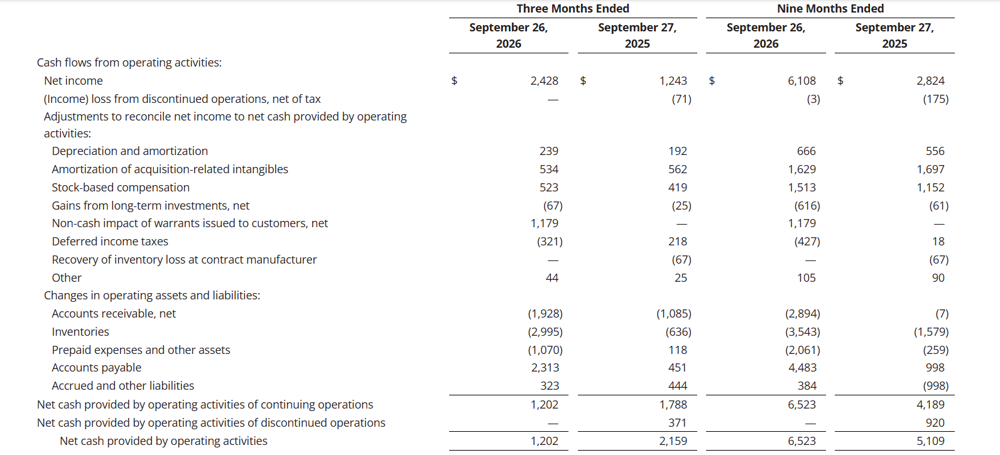
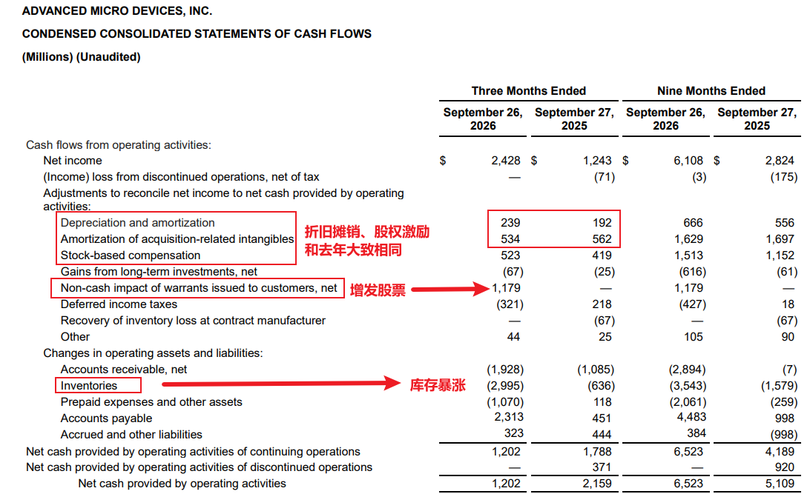
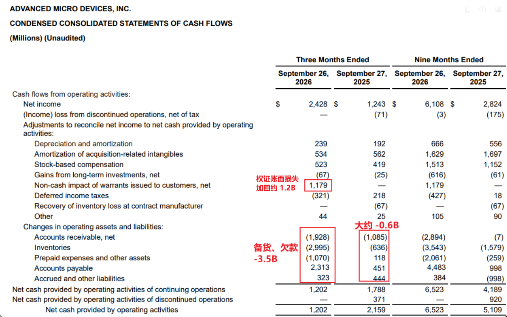
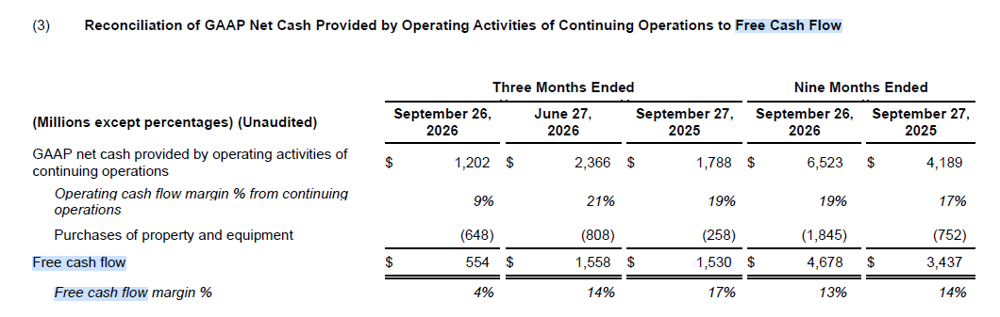

- [AMD 财务结果网站](https://ir.amd.com/financial-information/financial-results)
- [新闻稿网页(press release)](https://ir.amd.com/news-events/press-releases/detail/1303/amd-reports-third-quarter-2026-financial-results)
- [新闻稿 PDF](https://d1io3yog0oux5.cloudfront.net/_c6535fc3a678e68d3bb60c4bb4dc902e/amd/news/2026-11-03_AMD_Reports_Third_Quarter_2026_Financial_1303.pdf)

我们先解决如下问题：

1. 总体上看，业务赚不赚钱？增速如何
2. 业务拆分，哪些业务表现好，哪些业务表现不好？
3. 现金流如何？有没有负债上的雷点？
4. 未来预期的增速

## 业务赚不赚钱

业务是否赚钱就看毛利率、经营利润率、净利润率。

- Revenue: 营收
- Operating Income：营业利润
- Operating Margin：营业利润率

|            | GAAP(YoY)   | non-GAAP(YoY) |
| ---------- | ----------- | ------------- |
| 营收       | 13(+45%)    | 13(+45%)      |
| 毛利率     | 54%(+2ppts) | 56%(+2ppts)   |
| 营业费用率 | 33%(-5ppts) | 27%(-3ppts)   |
| 营业利润率 | 21%(+7ppts) | 29%(+5ppts)   |
| 营业利润   | 2.8(+123%)  | 3.9(+75%)     |
| 净收益     | 2.4(+95%)   | 3.4(+77%)     |
| EPS        | 1.46(+95%)  | 2.09(+74%)    |

可以看到增速很强劲，营收同比增速达到了 40% 以上，营业利润同比增速更是达到了 70% 以上。

50% 以上的毛利率，100 元卖出的芯片，成本只需要 50元，属于是暴利行业。  
至于 OpEx，包括 R&D 和 SG&A，大概是剩下的另一半。  
总体看下来，大概 1/4 - 1/3 的营收会转换为利润。

### 经营杠杆：利润增速远大于营收增速

营收同比 +45%，营业利润同比增长了 75%，相差太多，为什么呢？  
原因就是毛利率的提高和营业费用率的下降，下面提供一个例子。

假设营收是 100 元：

| 项目     | 原来 | 改善后 |
| -------- | ---: | -----: |
| 毛利润   | 54元 |   56元 |
| 营业费用 | 30元 |   27元 |
| 营业利润 | 24元 |   29元 |

1. 毛利率按照 50 算，营业利润按照 25 算，如果毛利率提高一个百分点，都能为利润带来 1/25 = 4% 的提升
2. OperatingExpense 同理，下降 1 个百分点，也能带来 4% 的提升
3. AMD 提升了 5 个百分点 的营业利润率，在 24 的基础上增长了将近 20%
4. 营收本身的增速 是 45%，1.45 * 1.2 = 1.74

可见只要 COGS 和 OpEx 占比不小，一点点改善就可以极大提升营业利润率，这就是经营杠杆。

### 营业利润两种统计口径相差 1B

营业利润两种会计准则相差了 1B，这里的差距可以看 slides 第 22 页给出的解释:
Reconciliation of GAAP Operating Income to Non-GAAP Operating Income

- 0.5B 的股票（Stock-based compensation）
- 0.5B 的收购相关无形资产的摊销（Amortization of acquisition-related intangibles）

> intangibles 在财报里指“无形资产”，例如技术、专利、商标、客户关系等：没有实物形态，但能为公司带来经济利益。
>
> - tangible：有形的、可以触摸的。
> - intangible：无形的。
> - intangibles：这里是 intangible assets（无形资产）的简写。

比如AMD收购一家公司，取得其已有技术和客户关系，会把符合条件的部分记为无形资产，再把其中使用寿命有限的资产成本分期计入费用。这个过程就叫“摊销”。

## 业务

AMD 将自己的业务分为三块：

1. Data Center
2. Client and Gaming
3. Embedded

各个业务营收：

- Data Center：8.5B
- Client & Gaming：3.7B
- Embedded：1B

其实都是 Data Center 贡献的，Data Center 占据了一半多的业务，营收同比增长 97%，营业利润同比增长 168%。
经营杠杆的效应体现得更明显。

我认为这就是 AMD 这种 fabless 的优势：它的产品可以快速的分发，R&D scale 的速度远小于出售服务器扩张的速度。

## 现金流

### 利润 2.4B，OCF 只有一半，同比下降 33%

前面看到，AMD 这个季度的净利润（Net income）是 2.4B。

在这里解释下，公司的利润不一定就是收到的现金，因为：

1. 签下了订单后，公司需要备货，那么现金就会变成库存（inventory）
2. 产品已经交付，收入已确认，但客户可能还没付款，因此利润与现金收入存在时间差
3. 利润是扣除了折旧摊销的结果，为了得到现金还需要加回来

> - receive：收到 → receivable：应当收到的。
> - pay：支付 → payable：应当支付的。
>
> 站在 AMD 的角度：
>
> | 词组                | 中文     | 谁欠谁钱？                 |
> | ------------------- | -------- | -------------------------- |
> | Accounts receivable | 应收账款 | 客户欠 AMD 钱，AMD 应当收  |
> | Accounts payable    | 应付账款 | AMD 欠供应商钱，AMD 应当付 |
>
> 例如，AMD 卖给客户 100 万元芯片，客户还没付款：  
> 对 AMD：这是 receivable，应收款。
> 对客户：这是 payable，应付款。
> 同一笔欠款，站在收钱方叫 receivable，站在付钱方叫 payable。

我们需要检查经营现金流（Operating Cash Flow），和自由现金流（Free Cash Flow）。

我第一次看 10-Q 文件，实际上写作「Net cash provided by operating activities」，经营活动提供的现金。

公司的业绩新闻稿在简明合并现金流量（CONDENSED CONSOLIDATED STATEMENTS OF CASH FLOWS）提供了现金流数据。

注意 10Q 文件提供的是 Nine Months Ended，也就是用 9 个月的 net income 计算的 OCF，但是新闻稿中额外提供了三个月的 OCF。



> GAAP net cash provided by operating activities of continuing operations
>
> GAAP 口径的持续经营活动现金净额

| 项目（B，十亿美元） | 2026 Q3 | 2026 Q2 | 2025 Q3 |
| ------------------- | ------: | ------: | ------: |
| 净利润              |   2.428 |   2.297 |   1.243 |
| 经营现金流 OCF      |   1.202 |   2.366 |   1.788 |

这个季度的现金流是 1.2B，去年同期是 1.7B，竟然下降了。  
按道理应该 net income 的增速一致的，我们只需要关注有哪些指标和去年同期相比增速不在 100%

括号中的数字表示要减去的，以 Changes in operating assets and liabilities（经营性资产和负债的变动）为例子：

- Accounts receivable, net (1928) 表示 应收账款要从 net income 中扣除 1928 Million，
  因为只是收到了客户的欠条，客户未来才会把钱给到。
- Inventories (2995) 表示库存，也就是为了备货，花掉了现金 2995 Million
- Prepaid expenses and other assets(1070): 预付费用及其他资产  
  钱已经提前付了，对应的服务或货物还没全部取得，暂时记作资产；之后再按用途转成费用或其他资产
  - 提前支付未来的研发服务费，可能先记为预付款，服务完成后再计入 R&D（研发费用）。
  - 提前支付办公室房租，可能先记为预付款，后续按月计入 SG&A。
  - 提前支付供应商的货款，收货后可能转入库存，卖出后再计入销售成本。
- Accounts payable +2313: 应付账款增加。
  已经向供应商采购，但部分货款还没支付，相当于我们欠供应商的钱。计算 OCF 时加回 2313 Million，抵消采购中尚未付款的部分
- Accrued and other liabilities +323：应计及其他负债增加。
  Accrued 指已经发生、已计入账目的费用等。
  例如，员工这个季度已经工作，奖金费用已计入利润，但奖金下个季度才发。费用已经扣减利润，现金仍留在公司，所以计算 OCF 时需要加回相应的增加额

1. 折旧摊销没有 double，导致现金流变少了
2. inventory 从 636 到 2995，说明备货占据了很多现金
3. 预付费用和去年同期相比转负
4. 应付账款从 451 增长到了 2313



- 去年 OCF - net income = 0.8B
- 今年 OCF - net income = -1.2B

理论上所有的指标和去年保持一致，那么 OCF 也要比 net income 多 0.8B 吧。
注意到Changes in operating assets and liabilities，去年合计是 -0.6B

今年因为库存和应收账款对 OCF 贡献 -3.5B，然后还有股权认证的非影响现金加回 1B，  
这两项指标今年对 OCF 贡献是 -2.5B，去年是 -0.6B。

所以今年 OCF 可以加回的现金要比去年少 1.9B，0.8-1.9=-1.1，大致相等。



### CAPEX 再吃掉一半 OCF

新闻稿最后一行是 CAPEX 和 FCF，CAPEX 在表格中的项目叫做「Purchases of property and equipment」。

AMD 披露的 Q3 单季 CAPEX 是 0.648B，比上季度的 0.808B 还少，约为 OCF 的一半。



按照公司在表格下方给出的定义，从 OCF 中扣掉 CAPEX，就得到自由现金流（Free Cash Flow，简称 FCF）：

```text
经营现金流 OCF       1.202B
− 资本开支 CAPEX     0.648B
＝ 自由现金流 FCF    0.554B

自由现金流率 = FCF ÷ 营收
             = 0.554 ÷ 13.377
             ≈ 4.1%
```

FCF 好歹还是正的，有些大厂 FCF 已经是负数了。下个季度要观察这些订单能不能按时交付，转换为现金。

## 展望

2026 Q4 revenue 预计 17B，环比 30%，继续爆发，毛利率 55%，和本季度差不多。
OpEx 还是只增加一点点，预期下个季度会继续上演营收杠效应。

non-GAAP 口径

|        | 本季度 | 下一季度  |
| ------ | ------ | --------- |
| 营收   | 13B    | 17B(+30%) |
| 毛利率 | 56%    | 55%       |
| OpEx   | 3.56B  | 3.75B     |

这个速度，给 30PE 不过分。

细化来说，我们还需要看其他分析师给出的，这个业务还能够增长多少的评价。

> 2027 财年，共识 EPS 15.72 美元。  
> 2026、2027、2028 三个财年的共识 EPS 增速分别是 81.9%、107.2% 和 45.1%。
>
> Darren 美股频道

假设 2028 年大厂的 CAPEX 会放缓，那么以后就没法保持 45% 这么高的同比增速了，
如果没有新的需求端出现，甚至可能进一步放缓，因为半导体是周期性行业。

按照 PEG=1估值，再打个八折，45 * 0.8 = 36，给 36x fwd PE = 565。

对于这种高波动的成长股，我只愿意给个 30PE，450 的话再看看吧。
